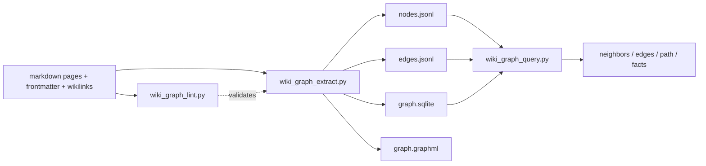

<!-- Adapted from: docs/graph.html (source: skills/llm-wiki/references/graph-workflow.md). -->

# グラフ層 {#graph-layer}

グラフは、markdown の wiki をもとにコンパイルする任意のインデックスである。出典つきの型付きの関係をプログラムからクエリできるようにしつつ、正本はあくまで markdown のままにする。グラフはいつでもページから作り直せる。

::: info
グラフ層はオプトイン方式である。`wiki/graph/ontology.yaml` がなければ、その wiki はグラフ層を導入する前の状態である。extract、lint、query を実行してはならず、オントロジーのファイルをでっち上げてもならない。先にグラフ層を初期化する（[`/wiki:graph`](/commands#graph) または [`/wiki:init`](/commands#init) を使う）か、グラフ層なしで進める。
:::

正本は markdown のページであり、下の図の成果物はすべて生成物なので、いつでも削除して作り直せる。



## グラフが表すもの {#what-the-graph-captures}

extract を実行すると、次の3種類のエッジができる。

1. **型付きの意味のエッジ。** ページの frontmatter の `graph.relationships[]` で宣言したもの（`founded`、`proposed`、`depends_on` など）。どのエッジも、明示的な `source`（ソースページのスラッグ）、`evidence` の引用、`confidence`（high/medium/low）、`status`（current/historical/proposed/disputed/superseded）を持つ。抽出スクリプトがこれらを勝手に作ることはない。
2. **`mentions` エッジ。** 本文の `[[wikilink]]` 1つにつき1本で、ページ内の重複はまとめられ、確信度は `low` になる。目的のページを早く見つけるためのもので、型付きの関係の証拠にはならない。
3. **`sourced_from` と `summarizes_raw` のエッジ。** 前者はソースページ以外のページの `sources:` リストからソースページへ、後者はソースページの `raw:` フィールドから raw ファイルへ張られる。

## frontmatter のスキーマ {#frontmatter-schema}

型付きの関係は、ページの frontmatter に書く。

```yaml
graph:
  node_id: person:praney-behl       # 任意。既定は <node_type>:<slug>
  node_type: person                 # 任意。既定はオントロジーの対応付けで決まる
  canonical: true                   # 複数のスラッグが1つのエンティティの別名になっている場合
  aliases: [Praney, praney@example.com]
  relationships:
    - predicate: founded
      object: company:seedblocks
      source: praney-founder-context-dump
      evidence: "Solo technical founder and sole director..."
      confidence: high
      status: current
```

関係に必須のフィールドは `predicate`、`object`、`source`、`evidence`、`confidence`、`status` である。`node_id` は `<node_type>:<slug>` の形をとる。

## オントロジー {#the-ontology}

`wiki/graph/ontology.yaml` は、グラフの仕様を決めるファイルである。`node_types[*].maps_from`（ページの `type` や `kind` をどのノード種別に対応させるか）と、`predicates[*]`（使える述語と、その `subject_types`、`object_types`、`requires_evidence`）を宣言する。`"*"` はワイルドカードである。分野固有の述語を追加するときはオントロジーを編集し、lint を再実行して、既存のエッジがオントロジーに合っているかを検証する。

## 型付きエッジと通常の wikilink の使い分け {#typed-edge-vs-plain-wikilink}

特定のソースが関係をはっきり述べていて、証拠を引用でき、その述語が後のクエリで意味を持つなら、**型付きエッジ**を追加する。関係が暗黙的なもの、1つの引用に結びつけられないもの、`mentions` エッジにしかならないものには、通常の **`[[wikilink]]`** を使う。迷ったら wikilink を書けばよい。lint は証拠の欠落を指摘するが、関係を控えめに書いたことを問題にはしない。

## extract、lint、query {#extract-lint-query}

```bash
# まず型付きメタデータを検証する。lint はファイルを編集しない。
uv run --script skills/llm-wiki/scripts/wiki_graph_lint.py wiki/

# nodes.jsonl、edges.jsonl、graph.sqlite、graph.graphml にコンパイルする。
uv run --script skills/llm-wiki/scripts/wiki_graph_extract.py wiki/

# グラフをたどる。
python skills/llm-wiki/scripts/wiki_graph_query.py wiki/ neighbors --node product:konvy
python skills/llm-wiki/scripts/wiki_graph_query.py wiki/ edges    --subject person:stephanie-emmanouel
python skills/llm-wiki/scripts/wiki_graph_query.py wiki/ path     --from person:praney-behl --to product:konvy
python skills/llm-wiki/scripts/wiki_graph_query.py wiki/ facts    --about product:konvy
```

`--json` は lint と query のどちらのコマンドでも使える。同じ操作は、スラッシュコマンドの [`/wiki:graph`](/commands#graph) からも実行できる。回答では、必ず wiki ページとその raw ソースを出典として示す。グラフはどのページを読めばよいかを教えるものであり、グラフそのものは証拠ではない。

## 生成物の扱い {#generated-artifact-policy}

| ファイル | 正本か | 既定の管理方法 |
| --- | --- | --- |
| `ontology.yaml` | 正本。手で編集する | git で管理する |
| `nodes.jsonl` | 生成物 | 任意。PR でグラフの差分を見たいなら git で管理する |
| `edges.jsonl` | 生成物 | 任意。上と同じ |
| `graph.sqlite` | 生成物 | 既定で gitignore する（大きいバイナリのため） |
| `graph.graphml` | 生成物 | 既定で gitignore する |

::: info
グラフの lint と抽出は、PyYAML 6.0.3 にバージョンを固定したメタデータを持ち、`uv run --script` で実行される。手作業での `pip install` は不要である。グラフのクエリは Python の標準ライブラリだけを使う。
:::
