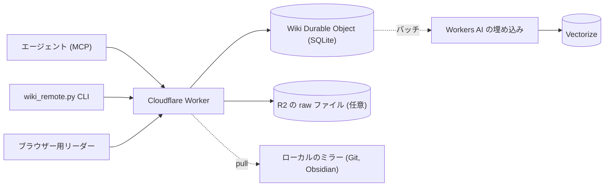

# ホスト型 wiki {#hosted-wiki}

ホスト型 wiki は、LLM Wiki をあなた自身のアカウントの Cloudflare Worker に置くものである。どのマシンのエージェントも、MCP か JSON API を通じて wiki を読み書きできる。正本は引き続き Markdown のページである。ブラウザー用のリーダーで、ページ、履歴、レビューフラグを見られる。

ホスト型 wiki は任意で使うもので、ローカルの wiki はこれまでどおり動く。ホスト型 wiki を使うのは、次のような場合である。

- 複数のエージェントやマシンで、1つの wiki を共有する必要がある
- シェルやファイルにアクセスできないエージェントがある（リモートのエージェント、CI、チャットのクライアントなど）
- 作成者つきのコミット履歴、競合のチェック、ブラウザー用のリーダーがほしい

[](https://deploy.workers.cloudflare.com/?url=https://github.com/praneybehl/llm-wiki-plugin/tree/main/server)

## 仕組み {#how-it-works}



- 1つの Worker がすべてを受け持つ。`/mcp` の MCP、`/api/v1` の JSON API、OAuth、セットアップページ、リーダーである。
- 各 wiki は1つの SQLite Durable Object である。1つのデプロイに複数の wiki を置ける。たとえば、個人用の wiki とプロジェクトごとの wiki を同じデプロイに置ける。
- 書き込みはすべてコミットになる。コミット内の操作は、すべて適用されるか、1つも適用されないかのどちらかである。各コミットは作成者を記録し、古いリビジョンを残す。
- 検索はハイブリッド検索である。SQLite FTS5 の BM25 と、Vectorize に格納した Workers AI `@cf/baai/bge-small-en-v1.5` のベクトルの結果を、ローカルの `wiki_search.py` と同じように RRF で統合する。
- サーバーは、検索用の行、リンク、グラフを同じコミットの中で更新する。ベクトルは数秒後にバッチで追いつく。

## デプロイ {#deploy}

### ボタンでデプロイする {#with-the-button}

1. 上の **Deploy to Cloudflare** をクリックする。
2. Cloudflare にサインインし、GitHub か GitLab のアカウントを選ぶ。Cloudflare が `server/` フォルダーを、あなたのアカウントの新しいリポジトリにコピーする。非公開のコピーにするなら **Create private Git repository** を選ぶ。
3. KV 名前空間と R2 バケットは **Create new** のままにする。
4. Vectorize インデックスも **Create new** のままにする。**Dimensions** に `384` を入力し、**Metric** で `cosine` を選ぶ。ハイブリッド検索にはこの値が必要である。
5. `ADMIN_TOKEN` に値を入力する。`openssl rand -hex 32` の出力のような、長いランダムな値を使う。値はパスワードマネージャーに保管する。
6. **Deploy** をクリックする。Cloudflare が Worker、Durable Objects、KV 名前空間、R2 バケット、Vectorize インデックス、Workers AI バインディングを作成し、`npm run deploy` を実行する。所要時間は1分ほどである。

ほかの手順は不要である。wiki は `https://llm-wiki.<your-subdomain>.workers.dev` で使える。

::: warning 新しいアカウントでの R2
R2 の利用登録には、無料枠でも決済の手続きがある。R2 バケットの作成でデプロイが失敗した場合は、Cloudflare のダッシュボードで R2 を有効にしてから、もう一度デプロイする。R2 がない場合、raw ファイルは、それを取り込んだエージェントのマシンに残る。
:::

### CLI でデプロイする {#with-the-cli}

Node.js 22 以降と、Cloudflare のアカウントが必要である。

```bash
git clone https://github.com/praneybehl/llm-wiki-plugin.git
cd llm-wiki-plugin/server
npm ci
npx wrangler login
openssl rand -hex 32                      # この値を ADMIN_TOKEN として保管する
printf 'ADMIN_TOKEN=%s\n' '<your-admin-token>' > .admin.env
npm run deploy -- --secrets-file .admin.env
rm .admin.env
```

`ADMIN_TOKEN` は必須のシークレットなので、初回のデプロイでは `--secrets-file` で渡す必要がある。`npm run deploy` は、Vectorize インデックスがなければ作成してからデプロイする。あとで更新するときは、リポジトリを pull して、もう一度 `npm run deploy` を実行する。あとでシークレットを変えるときは、`npx wrangler secret put ADMIN_TOKEN` を実行する。

## 初回の設定 {#first-run}

1. `https://<your-worker>/setup` を開く。
2. `ADMIN_TOKEN` でサインインする。
3. 最初の wiki を作成する。既定の ID は `main` である。wiki の ID に使えるのは、英小文字、数字、ハイフンである。
4. エージェントごとにトークンを1つ作成する（[トークン](#tokens)を参照）。
5. セットアップページから、エージェントのクライアントごとの MCP 設定をコピーする。

任意: [ローカルの wiki を移行する](#migrate-a-local-wiki)。

## トークン {#tokens}

エージェントごとに専用のトークンを発行する。トークンのラベルが、そのエージェントが作る各コミットの作成者になるので、どのエージェントが何を変えたかを履歴で確かめられる。

| スコープ | 許可される操作 |
|---|---|
| `read` | ページ、検索、履歴、グラフ、lint、raw ファイルの読み取り |
| `write` | コミット、revert、レビューフラグの解決 |
| `raw:write` | raw ファイルのアップロード |
| `admin` | この wiki の設定とトークンの管理。ほかのすべてのスコープを含む。 |

- トークンの形式は `lw_<wiki>_<secret>` である。サーバーが保存するのは、シークレットの SHA-256 ハッシュだけである。トークン全体が表示されるのは一度だけである。
- トークンは、セットアップページか CLI で作成する。

  ```bash
  python3 skills/llm-wiki/scripts/wiki_remote.py login --url https://<your-worker> --token -
  python3 skills/llm-wiki/scripts/wiki_remote.py token create --label claude-laptop --scopes read,write
  python3 skills/llm-wiki/scripts/wiki_remote.py token list
  python3 skills/llm-wiki/scripts/wiki_remote.py token revoke <id>
  ```

- `ADMIN_TOKEN` は、デプロイ全体を操作できるトークンである。エージェントには渡さない。`ADMIN_TOKEN` を使うときは、`X-LLM-Wiki: <id>` ヘッダーか `?wiki=<id>` で wiki を指定する。
- エージェントのトークンは、`LLM_WIKI_TOKEN` のような環境変数に入れておく。トークンを wiki のページ、メモリファイル、リポジトリに書いてはならない。

## OAuth {#oauth}

OAuth に対応した MCP クライアントは、トークンなしで接続できる。サーバーは、動的クライアント登録と、クライアント ID メタデータドキュメントに対応している。

1. サーバーの URL `https://<your-worker>/mcp` を、`Authorization` ヘッダーなしでクライアントに追加する。
2. クライアントからサインインを始める（Claude Code なら `/mcp`、Pi なら `pi mcp login llm-wiki` など）。クライアントは、自身のリクエストパラメーターを付けて、サーバーの認可ページをブラウザーで開く。`https://<your-worker>/authorize` を自分で開いてはならない。クライアントからのリクエストがないと、サインインを完了できない。
3. wiki の所有者であることを証明する。`ADMIN_TOKEN` か、使い捨てのペアリングコードを入力する。
4. wiki とアクセス権（読み取りのみ、または読み書き）を選ぶ。
5. エージェントに `wiki_overview` を呼び出させて、接続を確かめる。

OAuth で発行されるトークンは、MCP クライアントにだけ渡る。CLI（`wiki_remote.py` の import、pull、export、raw のアップロード）には、引き続きエージェントのトークンと `wiki_remote.py login` が必要である。

ペアリングコードの有効期限は10分で、一度しか使えない。セットアップページか、`python3 skills/llm-wiki/scripts/wiki_remote.py pair --label <label> --scopes read,write` で作成する。スコープには `read` か `admin` を含める必要がある。`ADMIN_TOKEN` を入力したくないデバイスでクライアントを承認するときは、ペアリングコードを使う。

OAuth のスコープは `wiki:read` と `wiki:write` である。ディスカバリードキュメントは `/.well-known/oauth-authorization-server` と `/.well-known/oauth-protected-resource/mcp` にある。

## MCP でエージェントを接続する {#connect-agents-over-mcp}

MCP のエンドポイントは `https://<your-worker>/mcp`（Streamable HTTP）である。最初に、シェルでトークンを設定する。

```bash
export LLM_WIKI_TOKEN=lw_main_...
```

セットアップページには、あなたの URL を埋めた同じ設定が表示される。`python3 skills/llm-wiki/scripts/wiki_remote.py mcp-config <client>` で出力することもできる。指定できるクライアントは `claude-code`、`codex`、`cursor`、`gemini`、`opencode`、`omp`、`pi`、`generic` である。このコマンドは、`--show-token` を付けない限りトークンを表示しない。

**Claude Code**

```bash
claude mcp add --transport http llm-wiki https://<your-worker>/mcp --header "Authorization: Bearer $LLM_WIKI_TOKEN"
```

または `.mcp.json` に書く。

```json
{"mcpServers": {"llm-wiki": {"type": "http", "url": "https://<your-worker>/mcp",
  "headers": {"Authorization": "Bearer ${LLM_WIKI_TOKEN}"}}}}
```

**Codex**（`~/.codex/config.toml`）

```toml
[mcp_servers.llm-wiki]
url = "https://<your-worker>/mcp"
bearer_token_env_var = "LLM_WIKI_TOKEN"
```

**Cursor**（`~/.cursor/mcp.json`）

```json
{"mcpServers": {"llm-wiki": {"url": "https://<your-worker>/mcp",
  "headers": {"Authorization": "Bearer ${env:LLM_WIKI_TOKEN}"}}}}
```

**Gemini CLI**（`~/.gemini/settings.json`）

```json
{"mcpServers": {"llm-wiki": {"httpUrl": "https://<your-worker>/mcp",
  "headers": {"Authorization": "Bearer $LLM_WIKI_TOKEN"}}}}
```

**OpenCode**（`opencode.json`）

```json
{"$schema": "https://opencode.ai/config.json",
 "mcp": {"llm-wiki": {"type": "remote", "url": "https://<your-worker>/mcp", "enabled": true,
   "headers": {"Authorization": "Bearer {env:LLM_WIKI_TOKEN}"}}}}
```

**OMP**（すべてのプロジェクトで使うなら `~/.omp/agent/mcp.json`、1つのプロジェクトで使うなら `.omp/mcp.json`）

```json
{"mcpServers": {"llm-wiki": {"type": "http", "url": "https://<your-worker>/mcp",
  "headers": {"Authorization": "Bearer ${LLM_WIKI_TOKEN}"}}}}
```

**Pi**（すべてのプロジェクトで使うなら `~/.pi/agent/mcp.json`、1つのプロジェクトで使うなら `.pi/mcp.json`）。Pi は MCP に標準で対応している。プロジェクトのファイルを読むのは、そのプロジェクトを信頼したあとだけである。詳しくは [Pi の MCP ドキュメント](https://pi.dev/docs/latest/mcp#configure-servers)を参照。

```json
{"mcpServers": {"llm-wiki": {"type": "http", "url": "https://<your-worker>/mcp",
  "headers": {"Authorization": "Bearer ${LLM_WIKI_TOKEN}"}}}}
```

シェルから `pi mcp add llm-wiki --url https://<your-worker>/mcp --bearer-token-env-var LLM_WIKI_TOKEN` で追加することもできる。`pi mcp list` で接続を確かめる。

**そのほかのクライアント**（Hermes、OpenClaw、自作のエージェント）: URL `https://<your-worker>/mcp` とヘッダー `Authorization: Bearer <token>` を使う。MCP に対応していないエージェントは、同じヘッダーで `/api/v1` の JSON API を使うか、CLI を使う。

そのあと、wiki の場所をエージェントに伝える。Claude Code では `/wiki:init --hosted https://<your-worker>` を実行する。このコマンドは接続情報を保存し、MCP の設定を出力し、メモリに書く記述を提案して承認を求める。ほかのエージェントでも、自然な言葉で頼めば（「...にある私のホスト型 wiki に接続して」）同じ流れになる。

### MCP ツール {#mcp-tools}

| ツール | 用途 |
|---|---|
| `wiki_overview` | `SCHEMA.md`、`index.md`、件数、現在の `seq`、ベクトルの遅れ、有効なオプションを返す。エージェントは最初にこれを呼び出す。 |
| `wiki_read` | ページ、1つの見出し、行の範囲、またはフォルダーの一覧を読む |
| `wiki_search` | `type`、`tag`、`since` のフィルターを使ったハイブリッド検索または語彙ベースの検索。被リンクのモードと、リンク数上位のモードもある |
| `wiki_commit` | アトミックな操作: `create`、`edit`、`append`、`put`、`delete`、`move` |
| `wiki_history` | コミット、差分、古いリビジョン、revert |
| `wiki_graph` | グラフのクエリとエクスポート |
| `wiki_lint` | 構造とグラフの lint、未解決のレビューフラグ |
| `wiki_raw` | raw ファイルの一覧、情報の取得、分割での読み取り。小さいテキストファイルの保存 |

### 競合 {#conflicts}

2つのエージェントが、同じページを同時に変更することがある。`edit` 操作は、現在のページにちょうど1回だけ出現するテキストを置き換えるので、同時に行われた編集の大半は競合せずに適用される。`append` は競合しない。変更を適用できないとき、サーバーは競合（HTTP 409）を、現在のリビジョンと差分とともに返す。スキルの指示により、エージェントはページを読み直し、変更をやり直して再試行する。変更が失われることはない。

## ローカルの wiki を移行する {#migrate-a-local-wiki}

Claude Code では `/wiki:migrate` を実行する。ほかのエージェントでも、自然な言葉で頼めば同じ手順を実行する。手順は次のとおりである。

```bash
REMOTE=skills/llm-wiki/scripts/wiki_remote.py
python3 $REMOTE import ~/wiki --raw ~/wiki/raw --dry-run   # レポートのみ
python3 $REMOTE import ~/wiki --raw ~/wiki/raw             # アップロード
```

- インポートは小さなバッチに分けて送る。サーバー上の内容と同じファイルはスキップする。途中で止まったら、もう一度実行すれば続きから再開する。
- `SCHEMA.md`、`index.md`、`log.md`、`indexes/`、`graph/ontology.yaml` を含め、UTF-8 のテキストのページをすべてアップロードする。隠しフォルダーと隠しファイル（`.git`、`.obsidian`、`.wiki-cache`、`.evolution`）は、トップレベルのテンプレートを除いてスキップし、レポートにも載せない。
- raw ファイルは、SHA-256 とともに R2 に送られる。raw ファイルを送らないときは `--no-raw` を使う。
- 内容が異なり、以前のインポートが書いたものでもないリモートのページは置き換えない。その場合は、何も書き込まずに終了コード 3 で止まる。そのようなページを置き換えるには `--overwrite` を付ける。インポートの実行中にほかの書き手が変更したページも置き換えない。そのページはレポートの `pages.changed_during_import` に載り、終了コードは 3 になる。
- 最後に、選んだすべてのファイルの SHA-256 をサーバーのマニフェストと比べ、JSON のレポートを出力する。終了コード 1 は不一致があることを示す。

終了コード 0 は、すべてのファイルが選ばれたことを保証するものではない。レポートの `skipped` と `raw.skipped` のリストを読む。各項目には `path` と `reason` がある。

| 理由 | 意味 | 対処 |
|---|---|---|
| `generated` | `graph/` 内の生成ファイル（たとえば `nodes.jsonl`、`graph.sqlite`）。グラフはサーバーが作り直す。 | 不要。想定どおりの除外である。 |
| `too_large` | ページが 1,500,000 バイトを超えている。 | ページを分割する。 |
| `not_utf8`、`not_text` | ファイルが UTF-8 のテキストではない。 | 変換するか、バイナリのソースなら raw フォルダーに移す。 |
| `symlink` | ファイルまたはフォルダーがシンボリックリンクである。 | リンク先を wiki の中にコピーする。 |
| `invalid_path`、`path_too_long` | サーバーがそのパスを受け付けない。 | ファイル名を変える。 |

ソースコンテンツが欠けているファイルは、それぞれ直してからインポートを再実行するか、ファイル名を挙げて了承する。インポートのあとは、`python3 $REMOTE lint` の結果をローカルの lint と比べ、いくつか検索を試す。エージェントの指示を変えるのは、レポートに不一致も欠けているソースコンテンツもないことを確かめてからにする。インポートの間、ローカルの wiki は変わらないので、どの手順でも中止できる。

## ローカルのミラーを維持する {#keep-a-local-mirror}

```bash
python3 skills/llm-wiki/scripts/wiki_remote.py pull ~/wiki --git
```

- `pull` は、前回の pull 以降の変更だけをコピーする。どこまで取得したかは `~/wiki/.llm-wiki-remote.json` に記録する。
- フォルダーが Git リポジトリなら、`--git` を付けると pull のたびにコミットを1つ作る。Git の履歴と Obsidian はそのまま使える。
- ミラーは読み取り専用である。ミラーで編集しても、サーバーには反映されない。ミラーのファイルがローカルで変更されていた場合、`pull` はサーバーのコピーを書き込む前に、ローカルのコピーを `<file>.local-<timestamp>` として保存し、そのことを報告する。
- `/wiki:learn` と `/wiki:evolve` はローカルで動く。ミラー上で実行する。
- ミラーを最新に保つには、`pull` を定期実行（cron、launchd）する。

## バックアップと履歴 {#backup-and-history}

- 変更はすべて、リビジョンを持つコミットになる。履歴は、リーダーの `/ui/<wiki>/history`、または `wiki_history` や `wiki_remote.py history` で確認する。
- `revert` は、古いコミットを取り消す新しいコミットを作る。履歴は消えない。
- `python3 skills/llm-wiki/scripts/wiki_remote.py export wiki-backup.tar.gz` で、いつでも全ページを書き出せる。
- Durable Objects には、30日分のポイントインタイムリカバリーがある。

## ブラウザー用リーダー {#browser-reader}

`https://<your-worker>/ui/<wiki>/` を開き、`ADMIN_TOKEN` か `read` スコープを持つトークンでサインインする。リーダーには、フォルダーのツリー、検索、プロパティ・被リンク・アウトラインつきでレンダリングしたページ、差分つきのコミット履歴、未解決のレビューフラグが表示される。リーダーは読み取り専用で、変更はエージェントが行う。

## Free プランと Paid プラン {#free-and-paid-plans}

サーバーは Workers の Free プランで動く。Paid プランでは、同じコードがより高い上限で動く。

| 項目 | Workers Free | Workers Paid（月額 $5） |
|---|---|---|
| Worker のリクエスト | 1日 100,000 件 | 月 1,000 万件、超過分は 100 万件あたり $0.30 |
| リクエストごとの CPU 時間 | 10 ms（Worker） | 既定で 30 秒、最大 5 分 |
| Durable Object の SQLite ストレージ | アカウントあたり 5 GB | オブジェクトあたり 10 GB |
| Durable Object の書き込み行数 | 1日 100,000 行 | 月 5,000 万行、超過分は 100 万行あたり $1.00 |
| Durable Object の読み取り行数 | 1日 500 万行 | 月 250 億行 |
| Workers AI | 1日 10,000 ニューロン | 1日 10,000 ニューロン、超過分は 1,000 ニューロンあたり $0.011 |
| Vectorize | 保存 500 万次元、クエリ月 3,000 万次元 | 保存 1,000 万次元、クエリ月 5,000 万次元 |
| R2 | 月 10 GB、書き込み 100 万回、読み取り 1,000 万回（利用登録には決済の手続きが必要） | 同じ無料枠、超過分は 1 GB・月あたり $0.015 |

数値は、2026年10月時点の Cloudflare の料金ページによる。決める前に、最新の [Workers の料金](https://developers.cloudflare.com/workers/platform/pricing/)を確認すること。

### 個人用 wiki のコスト {#costs-for-a-personal-wiki}

約 2,700 セクションと 600 MB の raw ファイルを持つ wiki での見積もりである。

| 項目 | 使用量 | Free プランの上限に占める割合 |
|---|---|---|
| 全セクションの初回のベクトル化 | 約 1,500 ニューロン | 1日分の 15% |
| 日々のベクトル化（変更されたセクション 200 件、検索 500 回） | 1日 約 400 ニューロン | 4% |
| Vectorize の保存量 | 2,700 セクション x 384 次元 | 21% |
| Vectorize のクエリ量 | 月 15,000 回の検索 | 23% |
| R2 の raw ファイル | 602 MB | 6% |
| インポートでの書き込み行数 | 20,000〜40,000 行 | 1日分の 20%〜40% |

個人用の wiki なら Free プランに収まる。大きなインポートでは、Free プランの1日分の書き込み行数の大部分を使うことがある。上限に達してインポートが止まったら、翌日にもう一度実行すれば続きから再開する。

任意の[判定モデル](/decisions)には、別途コストがかかる。

## 制限 {#limits}

| 項目 | 上限 |
|---|---|
| 1回のコミットに含められる操作 | 200 |
| 1回のコミットのサイズ | 4 MB |
| 1ページのサイズ | 1,500,000 バイト、UTF-8 のテキスト |
| JSON API または MCP のリクエストボディ | 5 MiB |
| raw ファイル1件のアップロード | 100 MB（Workers のリクエストの上限） |
| パス | POSIX の相対パス、最大 512 バイト、`..` を含まない、先頭が `/` でない、バックスラッシュを含まない |

`.` で始まるページのパスは受け付けない。ただし、`.pattern-template.md` のようなトップレベルのテンプレートファイルは除く。

## セキュリティ {#security}

- wiki のテキスト、raw ファイル、ベクトルは、あなたの Cloudflare アカウントの中にとどまる。ホスト型の[判定バックエンド](/decisions)を有効にしない限り、ほかのプロバイダーには送られない。
- サーバーが保存するのはトークンのハッシュで、トークンそのものは保存しない。`ADMIN_TOKEN` の比較は定数時間で行う。
- エージェントごとに専用のトークンを、必要最小限のスコープで発行する。デバイスを紛失したら、そのトークンを失効させる。
- `ADMIN_TOKEN` を変えるには、`npx wrangler secret put ADMIN_TOKEN` を実行する（またはダッシュボードでシークレットを変える）。変更すると、ブラウザーのセッションは終了する。
- リーダーは、厳格な Content Security Policy、`HttpOnly` と `Secure` を付けたセッション Cookie、フォームでの CSRF トークンを使う。ページの HTML はエスケープされる。
- raw ファイルは、アップロード後に変更できない。
- ソースのテキストは信頼できないものとして扱う。Web からの切り抜きに、エージェントへの指示が含まれていることがある。スキルは、ソースの中の指示に従わないようエージェントに指示している。任意の信頼できないテキストのスクリーニングを使うと、そうしたページにレビューフラグが付く。
- 任意: シングルサインオンを使うなら、`/setup` と `/ui/` の前段に [Cloudflare Access](https://developers.cloudflare.com/cloudflare-one/policies/access/) を置く。

## トラブルシューティング {#troubleshooting}

| 症状 | 確認すること |
|---|---|
| `401 unauthorized` | トークンが間違っているか失効している、またはヘッダーがない。`wiki_remote.py status` を実行する。 |
| `403 forbidden` | トークンに必要なスコープがない。`write` または `raw:write` を持つトークンを作る。 |
| raw のアップロードで `503` | デプロイに R2 バインディングがない。R2 を有効にして再デプロイするか、raw ファイルをローカルに置いたままにする。 |
| 検索モードが `lexical` になる | デプロイに Vectorize か Workers AI のバインディングがない。ボタンか `npm run deploy` で再デプロイする。 |
| `vector_lag` が 0 より大きいままになる | Workers AI が1日の上限に達したか、失敗した。サーバーがあとで再試行する。キーワード検索は引き続き使える。 |
| インポート後、約10分たっても `vector_lag` が 0 より大きい | Vectorize は、特に新しいインデックスを作った直後に、upsert を取りこぼすことがある。サーバーは各ベクトルを確認し、欠けているものを約10分後に再送する。対処は不要である。 |
| デプロイが `a namespace with this account ID and title already exists` で止まる | Worker は削除されたが、その `OAUTH_KV` 名前空間が残っている。`npx wrangler kv namespace list` を実行し、`<worker-name>-oauth-kv` の `id` を `wrangler.jsonc` の `OAUTH_KV` の項目に設定するか、その名前空間を削除する。通常のデプロイでは、デプロイ済みの Worker のバインディングがそのまま使われる。 |
