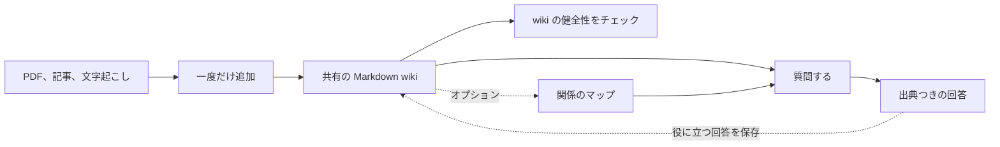

<!-- Adapted from: docs/index.html (source: README.md "What is this?", "Why use it", "Quick start"). -->

# LLM Wiki {#llm-wiki}

PDF、記事、文字起こし、メモを、AI エージェントが検索・引用し、最新に保てる共有 wiki に変える。

AI エージェントは目の前のタスクをこなすのは得意だが、新しいセッションは限られたコンテキストから始まる。LLM Wiki は、エージェントに共有メモリを与える。このメモリは、すべてのプロジェクトで使う個人用の wiki 1つに置くことも、特定のプロジェクトの中に置くこともできる。

ソースは一度追加すればよい。エージェントがそれをリンクでつながった Markdown のページに変える。あとから、エージェントは該当するセクションを見つけて出典つきで答え、役に立った学びを wiki に保存できる。

正本となるデータはすべて、読める Markdown のまま残る。ローカルのセマンティック検索には、いつでも作り直せる SQLite のベクトルインデックスを使い、ホスト型のベクトルデータベースや埋め込みサービスは使わない。多くのエージェントやマシンで1つの wiki を共有する必要がある場合は、オプションの[ホスト型 wiki](/hosted) を、自分の Cloudflare アカウントにワンクリックでデプロイできる。

## このプロジェクトがある理由 {#why-this-exists}

AI エージェントは、1つのセッションの中ではよい仕事ができる。問題は、チャットが終わったあとである。

役に立つ回答が、先週の会話に埋もれているかもしれない。決定事項が、会議の文字起こしの中にしかないかもしれない。修正点が、issue に書かれたままになっているかもしれない。こうしたコンテキストが散らばっていると、次のエージェントは同じファイルを探し、同じ理解を一から組み立て直すことになる。

LLM Wiki は、そうした作業の成果を残しておく場所になる。ソースはリンクでつながった Markdown になり、回答は出典を保ったまま残り、役に立つ結論は次のセッションや次のエージェントのために保存できる。

1つの会話が終わったあとも残しておくべき知識があるときに使う。長期にわたる調査、顧客との通話、プロジェクトの決定事項、繰り返し出る質問、複数のエージェントで分担する作業などである。一度きりの質問や構造化されたレコードには、チャットや通常のデータベースのほうが向いていることがある。


*ソースは一度追加し、あとで出典つきの証拠を取り出し、役に立った学びを保存し直す。そうすると、次のセッションは前回より多くの知識を持った状態で始まる。*

::: tip v4 の新機能
Cloudflare 上のオプションの[ホスト型 wiki](/hosted)。ワンクリックでデプロイでき、すべてのエージェントから MCP と JSON API でアクセスでき、エージェントごとのトークンまたは OAuth、履歴つきのアトミックなコミット、Workers AI によるハイブリッド検索、ブラウザー用のリーダー、pull ミラーを備える。オプションの[判定モデル](/decisions)を使うと、検索結果を関連度でふるい分けたり、弱い証拠にフラグを立てたりできる。ローカルの wiki に移行作業は要らない。詳しくは[アップグレード](/upgrade)を参照。
:::

## 仕組み {#how-it-works}

ソースはそれぞれ一度だけ追加する。あとからの質問には、raw ファイルから毎回やり直すのではなく、共有 wiki を使う。



## 3ステップで wiki を使い始める {#three-steps-to-a-working-wiki}

1. プロジェクトをまたいで共有する個人用の wiki を**初期化**する。

   ```bash
   /wiki:init --global
   ```

   wiki を現在のプロジェクトだけのものにしたい場合は、`--global` を付けずに `/wiki:init` を使う。

2. 最初のソース（PDF、記事、文字起こし）を**取り込む**。

   ```bash
   /wiki:ingest ~/wiki/raw/your-source.pdf
   ```

3. 蓄積した知識に、出典つきで**問い合わせる**。

   ```bash
   /wiki:query What does my wiki say about X?
   ```

Claude Code 以外を使っている場合も、同じスキルが Codex、Cursor、Pi、OMP などで動く。[はじめに](/getting-started)と[エージェント対応表](/agents)を参照。

## ドキュメントの一覧 {#explore-the-docs}

- **[はじめに](/getting-started)**: 使っているエージェント向けにインストールし、init、取り込み、クエリ、lint を順に試す。
- **[コマンド](/commands)**: すべての `/wiki:*` スラッシュコマンドの使い方と例。
- **[ワークフロー](/workflows)**: エンドユーザー向けに、取り込み、クエリ、lint を手順ごとに説明する。
- **[検索と取得](/search)**: ローカルのハイブリッド検索、セクション単位の BM25、JSON 形式の証拠、差分更新するキャッシュ。
- **[グラフ層](/graph)**: 出所を裏づけに持つ型付きの関係を扱う、オプションのコンパイル済みグラフ。
- **[ホスト型 wiki](/hosted)**: Cloudflare へのデプロイ、MCP でのエージェント接続、ローカルの wiki の移行とミラーの維持。
- **[判定モデル](/decisions)**: 検索結果をふるい分け、弱い証拠や信頼できないテキストにフラグを立てる、オプションの小さなモデル。
- **[エージェント](/agents)**: 対応しているコーディングエージェントと、それぞれのインストール方法。
- **[v4 へのアップグレード](/upgrade)**: v4 で変わる点と、v3 以前からのアップグレード方法。

## よくある質問 {#frequently-asked-questions}

### LLM Wiki とは何か {#what-is-an-llm-wiki}

LLM Wiki は、AI エージェントのための共有ナレッジベースである。ソースをリンクでつながった Markdown のページに変えて整理し、あとからの質問に出典つきで答える。

### LLM Wiki は RAG とどう違うのか {#how-is-llm-wiki-different-from-rag}

RAG は通常、質問のたびに raw ドキュメントのチャンクを検索する。LLM Wiki は、先に各ソースを役に立つページに整理する。あとからの質問では、リンク、修正、ソースの履歴も含めて、育っていく知識の集まりを検索する。

### ホスト型の埋め込みサービスやベクトルデータベースは必要か {#does-llm-wiki-require-a-hosted-embedding-service-or-vector-database}

必要ない。既定のセマンティック検索は FastEmbed と sqlite-vec でローカルに動き、正本は Markdown のままである。モデルもオプションのパッケージも一切使いたくない場合は、検索スクリプトを Python で直接実行し、`--no-embed` を付ければ純粋な Python の BM25 になる。オプションの[ホスト型 wiki](/hosted) は、自分の Cloudflare アカウントの Workers AI と Vectorize を使う。

### 複数のエージェントで1つの wiki を共有できるか {#can-several-agents-share-one-wiki}

できる。同じマシン上のエージェントは、ローカルのフォルダーを共有できる。複数のマシンにまたがるエージェントや、ファイルにアクセスできないエージェントには、[ホスト型 wiki](/hosted) をデプロイする。エージェントごとに専用のトークンを持ち、すべての変更は作成者つきのコミットになり、競合する編集は検出されて再試行される。

### LLM Wiki に対応しているコーディングエージェントは {#which-coding-agents-support-llm-wiki}

agentskills.io 互換のスキルが、Claude Code、Codex、Cursor、Gemini CLI、OpenCode、OpenClaw、Pi、OMP、Hermes に対応している。Claude Code では、プラグインを通じて `/wiki:*` スラッシュコマンドも使える。ほかのエージェントでは、同じワークフローを自然言語で呼び出す。[エージェント対応表](/agents)を参照。

### インストールして使い始めるには {#how-do-i-install-and-start-using-llm-wiki}

使っているエージェント向けにプラグインかスキルをインストールし、`/wiki:init` を実行し、`/wiki:ingest` でソースを取り込み、`/wiki:query` で出典つきの質問をする。構造と内容の問題を見つけるために、`/wiki:lint` を定期的に実行する。対応しているすべてのエージェントについて、正確なコマンドを[はじめにのガイド](/getting-started)に載せている。

---

LLM Wiki プラグイン、MIT ライセンス。[GitHub のソース](https://github.com/praneybehl/llm-wiki-plugin)。[Karpathy の LLM Wiki の gist](https://gist.github.com/karpathy/442a6bf555914893e9891c11519de94f) をもとにしている。セクション単位の取得は Cerebras の [How We Built Our Knowledge Base](https://www.cerebras.ai/blog/how-we-built-our-knowledge-base) を参考にし、ローカルの FastEmbed と sqlite-vec の構成は [Basic Memory](https://github.com/basicmachines-co/basic-memory) と比べて検証した。

## タスクの経験から学ぶ {#learning-from-task-experience}

任意で使う改善ワークフローは、[WikiSkill](https://arxiv.org/html/2608.27454v1) を応用し、経験の継続的な記録、パターンの統合、テスト済みのスキル変更として実装したものである。[応用の対応表と、測定された限界](./evolution.md#research-basis-and-adaptation)を参照。現時点の検証では、品質の向上は見られなかった。
