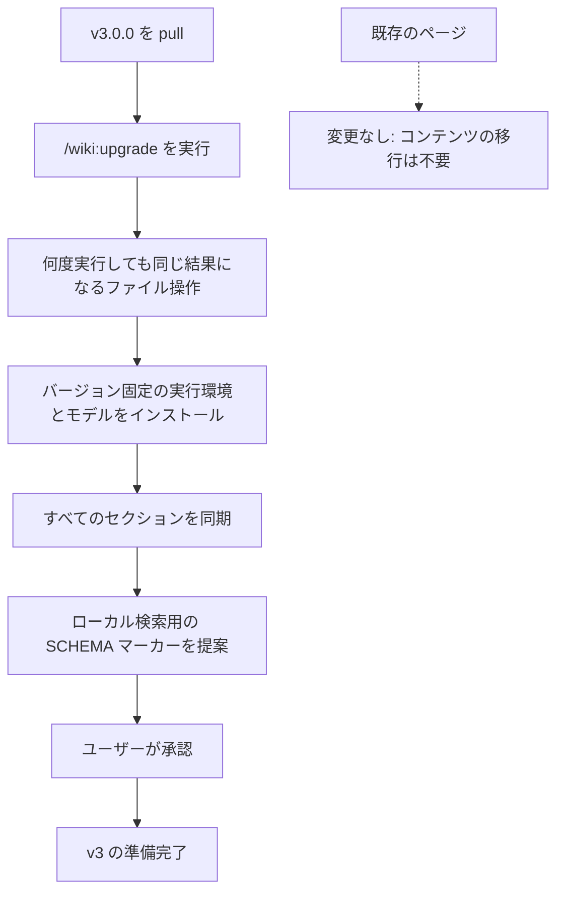

<!-- Adapted from: commands/wiki/upgrade.md and the v4 hosted wiki plan. -->

# v4.0.0 へのアップグレード {#upgrade-to-v4-0-0}

v4.0.0 では、オプションのホスト型バックエンドと、オプションの判定レイヤーが加わった。ローカルの wiki、ページの形式、ローカルの検索、すべてのコマンドは、これまでどおり動く。メジャーバージョンを上げたのは、Paperclip 連携を削除したためである。

## 変わる点 {#what-changes-for-you}

- **ローカルの wiki に移行作業は要らない。** `wiki/` の下は何も変わらない。ローカルの検索、lint、グラフ、改善のスクリプトも同じである。
- **ホスト型 wiki（オプション）。** Deploy ボタンで Cloudflare Worker を1つデプロイする。エージェントは、それぞれのトークンか OAuth を使い、MCP または JSON API で接続する。[ホスト型 wiki](/hosted) を参照。
- **新しいコマンド。** `/wiki:init --hosted <url>` は、エージェントをホスト型 wiki に接続する。`/wiki:migrate` は、ローカルの wiki をホスト型 wiki に移し、選んだすべてのファイルを検証し、スキップしたファイルを報告する。
- **新しい CLI。** `skills/llm-wiki/scripts/wiki_remote.py`（Python の標準ライブラリだけを使う）が、ログイン、トークン、インポート、pull ミラー、エクスポート、raw ファイル、MCP の設定を扱う。
- **判定モデル（オプション、既定では無効）。** 小さなモデルを使って、検索結果を関連度でふるい分けたり、グラフの証拠を確かめたり、信頼できないテキストを選別したりできる。[判定モデル](/decisions)を参照。
- **Paperclip 連携の削除。** `integrations/paperclip/` のプラグインとそのドキュメントはなくなった。npm パッケージは一度もレジストリに公開していないので、レジストリ側での対応は不要である。Paperclip が必要なら、v3.2.x を使い続ける。[v3.2.0 のドキュメント](/v3/)は引き続き参照できる。

## アップグレードの手順 {#the-upgrade}

1. インストールしたときと同じ方法で、**プラグインまたはスキルを更新する**。Claude Code では、マーケットプレイスからのインストールをもう一度実行する。スキルだけを使うエージェントでは、`npx skills add` をもう一度実行する。
2. wiki に対して **`/wiki:upgrade` を実行する**。v3.2 と同じ、何度実行しても同じ結果になるファイル操作と、実行環境のチェックを行う。`SCHEMA.md` に新しく加えるべきセクションはない。
3. **オプション: ホスト型 wiki に移る。** サーバーをデプロイしてから、`/wiki:migrate` を実行する。インポートが検証に通るまで、ローカルの wiki は変わらない。

::: info pull ミラー
フォルダーがホスト型 wiki の `pull` ミラーである（`.llm-wiki-remote.json` がある）場合は、そのフォルダーを編集したり、upgrade による書き込みを行ったりしてはならない。ホスト型 wiki のほうを変更してから、もう一度 pull する。
:::

## v3.2 より前からのアップグレード {#upgrading-from-before-v3-2}

v3.2.0 では、オプションの経験の記録と、評価済みのスキルの改善が加わった。既存の wiki、frontmatter、CLI のフラグは、引き続き互換性がある。バックグラウンドで動く最適化の仕組みが有効になることはない。

設定した wiki に対して `/wiki:upgrade` を実行する。既存の実行環境のセットアップは、引き続き必須である。アップグレードでは、`.experience-template.json`、`.pattern-template.md`、`.evolution/README.md` を、ない場合にだけ追加する。カスタマイズしたファイルと SCHEMA.md は保持される。レビュー用に、オプションの `## Skill evolution` スキーマセクションを提案する。

検証済みのタスクの経験には `/wiki:learn` を、根拠にもとづく改善案と、測定にもとづく採用には `/wiki:evolve` を使う。アップグレードの間に評価やスキルの置き換えが行われることはない。`.evolution/` は、いつでも作り直せる `.wiki-cache/` と違い、消えては困る履歴なのでバックアップしておく。ランナーの仕様、パイロットスイート、推論の予算、ロールバックについては[学習とスキルの改善](/evolution)を参照。

## v3.0 より前からのアップグレード {#upgrading-from-before-v3-0}


v3.0.0 では、プロバイダーを使った埋め込みが、既定のローカルの FastEmbed と sqlite-vec による検索に置き換わった。既存の Markdown には手を付けず、変わるのはいつでも作り直せるベクトルインデックスだけである。

::: info コンテンツの移行は不要
ページと frontmatter の形式は変わっていない。古い `embeddings.jsonl` キャッシュは無視されるので、削除してかまわない。`/wiki:upgrade` が `embeddings.sqlite` をローカルに作り、現在あるすべてのセクションを同期する。
:::



## メジャーバージョンを上げた理由 {#why-it-s-a-major-version}

既定のセクション検索は、プロバイダーを設定しない限り語彙ベースのままだったが、ローカルのモデルと sqlite-vec のインデックスを初期化するようになった。データはローカルの外に出なくなり、プロバイダー用の古い環境変数と承認フラグは削除された。`python wiki_search.py "<query>" --no-embed` で直接実行すれば、依存パッケージを使わない BM25 を引き続き使える。

## アップグレードの手順 {#the-upgrade-1}

1. **現在のリリースを取得する。** インストールしたときと同じ方法でプラグインを更新する。Claude Code では、マーケットプレイスからのインストールをもう一度実行する。スキルだけを使うエージェントでは、`npx skills add` をもう一度実行する。
2. **アップグレードを実行する。** Claude Code では次のとおり。

   ```bash
   /wiki:upgrade
   ```

   直接実行する場合は、インストール済みのスクリプトと、選んだベースディレクトリを別々に渡す。プロジェクトの wiki の場合:

   ```bash
   python "${CLAUDE_PLUGIN_ROOT}/skills/llm-wiki/scripts/init_wiki.py" "<absolute-project-root>" --upgrade
   ```

   標準の個人用グローバル構成の場合:

   ```bash
   python "${CLAUDE_PLUGIN_ROOT}/skills/llm-wiki/scripts/init_wiki.py" "<absolute-home-directory>" --wiki-dir wiki --raw-dir wiki/raw --upgrade
   ```

   スキルだけをインストールしている場合は、`${CLAUDE_PLUGIN_ROOT}/skills/llm-wiki` を、そのエージェントにインストールされた `llm-wiki` スキルのディレクトリに置き換える。プラグインやスキルのディレクトリを、ベースディレクトリとして使ってはならない。

   > **期待される動作**: 何度実行しても同じ結果になるファイル操作なので、既存のページには手が付かない。続いて実行環境のセットアップが `"status": "ready"` を返し、固定した依存パッケージのバージョン、モデル、ページ数、セクション数、ベクトルインデックスのパスを報告する。そのあとで、コマンドが SCHEMA に欠けているマーカーを報告する。
3. **SCHEMA.md のマージを承認する。** 現在のテンプレートにあるローカルのセマンティック検索のバックエンドについての行を、既存の `## Retrieval` セクションに追加する。SCHEMA.md はユーザーと一緒に改訂してきたものなので、黙って変更されることはない。

アップグレードは何度実行しても同じ結果になる。既存のコンテンツは変わらず、依存パッケージとモデルを確かめ、変わったベクトルと欠けているベクトルだけを作る。

## 変わる点 {#what-changes-for-you-1}

- **既存のページは変更不要。** `wiki/` の下にある正本は何も書き換えられない。
- **セクション検索の既定は、ローカルのハイブリッド検索になった。** FastEmbed と sqlite-vec によるセマンティックな順位を、BM25 の結果と統合する。依存パッケージを使わない語彙ベースの検索にするには、スクリプトを Python で直接実行して `--no-embed` を付ける。ページ単位で順位を付けるには `--granularity page` を使う。
- **アップグレードがすべてをインストールする。** このコマンドは、`uv` を通じてバージョンを固定した FastEmbed、sqlite-vec、PyYAML を解決し、固定したモデルがなければダウンロードし、パースキャッシュを作り、現在あるすべてのセクションをベクトル化する。
- **`wiki/.wiki-cache/` は作り直せる。** `search-index.json` と `embeddings.sqlite` は gitignore の対象で、削除してかまわない。旧来の `embeddings.jsonl` は無視される。
- **プロバイダーの設定はもう要らない。** API キー、エンドポイント、データ転送の承認、クエリごとの課金は一切ない。

::: warning
まだ wiki がない場合は、アップグレードするものがない。代わりに [`/wiki:init`](/getting-started) を実行する。
:::
