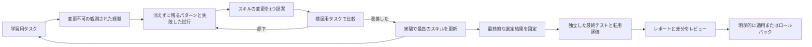

# 学習とスキルの改善 {#learning-and-skill-evolution}

任意で使える改善ループは、観測できるタスクの結果から学習し、wiki にパターンとしてまとめ、1つのスキル全体に対する変更を提案し、検証用のデータで改善を選ぶ。独立した最終テストを実行する前に、選んだスキルを固定する。インストール済みのスキルが変わるのは、得られた変更案を利用者が適用したときだけである。

## 研究の基礎と、このプロジェクトでの応用 {#research-basis-and-adaptation}

改善ループの設計は、Liyan Tang らによる論文 [WikiSkill: Compiling Agent Experience into Persistent Knowledge for Skill Evolution](https://arxiv.org/html/2608.27454v1)（Google Research と Virginia Tech、2026 年）をもとにしている。論文の[手法](https://arxiv.org/html/2608.27454v1#S3)と、この実装との対応は次のとおり。

| 論文の考え方 | LLM Wiki での実装 |
| --- | --- |
| 経験、蓄積した知識、スキルを分ける | 変更不可の学習時の記録、既存のソースページとコンセプトのページ、独立したスキルのディレクトリ |
| 実行、統合、提案を繰り返す | `wiki_evolve_loop.py` で回数を区切って行う、推論、メンテナー、プロポーザーの呼び出し |
| 変更案が失敗しても教訓を残す | 消えずに残るパターンと採否の履歴。却下された変更案や重複した変更案も、あとから確認できる |
| 出どころを記録しながらスキルを作る・改良する | 複数のテキストファイルにまたがる、スキル全体または新しいスキルの変更案と、`PURPOSE.md` による証拠との対応づけ |
| 検証による選別と独立したテスト | 検証で厳密に改善した候補を選ぶ。最終テストと、任意で行う別エージェント・別モデルへの転用評価の前に、選定結果を固定する |
| 評価中はスキルを直接与える | スキル全体をハッシュつきで注入し、スキルが呼び出されなかったことによる失敗は、測定する比較の対象から外す |

このプロジェクトでの応用では、事実情報を持つタスク用の wiki は推論から参照できるようにしつつ、最適化の学習履歴は推論に渡さない。1回の実行で扱うのは1つのスキルである。論文のようにツールを使って変更案を作るのではなく、与えた証拠から構造化された変更案を作る。保存するのは公開されたツールの観測結果で、非公開の推論は保存しない。エージェントが自分でスキルを段階的に見つけていく動作は、測定の対象にしていない。9種類のホスト用アダプター、取り込み・グラフ・ハイブリッド検索に対するアサーション、インストール済みスキルへの明示的な承認、持ち運べる証拠のバンドル、リクエスト前の API 費用の予約は、このプロジェクト独自の実装上の選択である。

これは論文の応用であり、論文のベンチマーク研究を再現したものではない。[公開しているワークフローの調査](https://github.com/praneybehl/llm-wiki-plugin/blob/codex/wiki-skill-evolution/eval/evolution/workflows/README.md)では、提案された2つの変更はどちらも却下され、品質の向上は確認できなかった。スキルを変えない場合と比べて、Codex は 3/8 対 2/8、Claude は 3/8 対 3/8 だった。レポートには、当初の評価器の制約と、その後の修正が残してある。5つのホストでは、まだアカウント、クライアント、ゲートウェイのセットアップが必要であり、API の予算を管理するランナーは、実際の API キーを使った試行をまだ行っていない。



## サイクル全体を実行する {#run-the-complete-cycle}

`/wiki:evolve` を使うか、スキルの改善を実行するようエージェントに頼む。事実情報のコーパス、学習用の wiki、raw ルート、対象のスキルは、それぞれ個別に特定する。スキルは作業用のコピーを使う。対象のディレクトリがない場合はスキルなしの状態から始まり、プロポーザーが新しくスキルを作る。知識のページを書く前に、wiki のスキーマを読む。

プラグインのリポジトリから `eval/evolution/pilot/config.example.json` をコピーし、アダプターのパスと正確なモデル ID を書き換える。ロールごとに専用のランナーとモデルを使う。推論（inference）はタスクを実行し、メンテナー（maintainer）は経験をまとめ、プロポーザー（proposer）はスキルを変更し、ジャッジ（judge）は回答を検証する。推論を始める前に、承認された実行予算を設定する。

```bash
python <skill-root>/scripts/wiki_evolve_loop.py \
  --wiki /path/to/learning-wiki --raw /path/to/raw \
  --id query-cycle-01 --skill /path/to/working-skill \
  --suite /path/to/suite-v2.json --config /path/to/config.json
```

ループは、上限を決めた回数だけ繰り返す。各反復では、学習時のツールイベント、回答、成果物、検証結果を記録し、再利用できるパターンを更新し、過去の試行を読み、複数のファイルにまたがる一貫した変更を提案し、それを現時点で最良のスキルと検証用タスクで繰り返し比較する。採用するには、検証での成績が厳密に上回っていなければならない。任意で、コストやツール呼び出しの比率、重要なタスクでの回帰チェックを加えて、選定の条件をさらに厳しくできる。却下された変更とその理由は、後続の変更案から参照できる。同じベースラインに対して、すでに却下された候補と同じ候補はスキップする。

すべての反復が終わると、選定結果を固定する。ベースラインと選ばれたスキルを、最終テスト用のタスクで実行する。その結果はレポートに載せるが、メンテナーやプロポーザーに戻すことはなく、別の候補を選ぶためにも使わない。任意の `transfer` の項目を設定すると、同じジャッジと予算を使い、固定した同じ比較を別のエージェントとモデルの組み合わせで実行する。最終テストの結果が悪ければ、採用を見送る理由になる。結果を見てしまったテストに合わせて最適化してよいということにはならない。のちに別の調査をするときは、新しいテスト用タスクを使う。学習用の wiki は、使用済みのテストのフィンガープリントを記録し、後続の最適化の実行で再利用されるのを拒否する。

実行が成功し、改善が選ばれた場合は、`<run-id>-selected` が作られる。これは既存のレビューと適用のコマンドでそのまま扱える。

```bash
python <skill-root>/scripts/wiki_evolve.py --wiki /path/to/learning-wiki show query-cycle-01-selected
python <skill-root>/scripts/wiki_evolve.py --wiki /path/to/learning-wiki apply query-cycle-01-selected
python <skill-root>/scripts/wiki_evolve.py --wiki /path/to/learning-wiki rollback query-cycle-01-selected
```

`wiki_evolve.py history` と `show <run-id>` では、ループ全体の実行と、そこで記録された判断も確認できる。実行が完了しても、どの変更も選ばれないことがある。実行時のエラーや予算の使い切りによって、適用できる状態の変更案が作られることはない。中断した実行は証拠を残すが、評価の入力をすでに見せたあとでは、同じ ID で再開することはできない。

## タスクと検証 {#tasks-and-verification}

バージョン 2 のスイートでは、`train`、`validation`、`test` のタスクを分け、ジャッジの較正用に正例と負例のケースを用意する必要がある。各タスクには、質問、意味にもとづく評価基準（ルーブリック）、回答を控えるべきかどうか、ソースのパスを書く。較正は学習の前に実行され、合格しなければならない。自分のジャッジを較正するときは、正しい言い換え、数値の誤った回答、矛盾、もっともらしいが根拠のない付け足しを含めておく。

推論のランナーが受け取るのは、タスク、事実情報の wiki、書き込みの権限、スキルの全内容だけである。評価基準、データの区分、期待する回答、どの候補かを示すラベル、学習履歴は受け取らない。アダプターはスキル全体を注入し、そのハッシュを返す。これで確かめられるのはスキルが渡されたことであり、モデルがすべての指示に従ったことではない。プロンプトでは実行の範囲と出力の形式を伝えるが、対象の手順そのものは教えない。

独立したジャッジが見るのは、質問、評価基準、回答、ソースの本文で、スキルやどの候補かは知らされない。ジャッジは意味とソースによる裏づけを確かめ、ソースからの正確な引用を添えて判定を返す。ハーネスは、それらの引用が実際にあるかを確かめ、出典と回答の控えを検証し、求められた成果物を確認する。ジャッジがツールを呼び出すと、その実行は無効になる。追加のツールを使って得た評価は、ブラインドな証拠として認めないためである。ジャッジは、測定したコマンドの出力と、ハッシュにもとづく整合性の観測結果も受け取る。取り込みのタスクでは、raw の入力を `sources` に含めておくと、要約が正確かを記録そのものと照らして確かめられる。これでキーワードの一致による誤りは減るが、較正したモデルのジャッジでも誤ることはある。重要な失敗はレビューし、効果があると主張するときは、サンプル数、モデル、繰り返した結果もあわせて報告する。

タスクの出力パスは、与えた wiki のルートからの相対パスである。タスクでは、`allow_write` のパターンと `artifacts` のチェックを宣言できる。チェックには、`text` や `json` の完全一致、必要なテキスト断片（`contains`）、オブジェクトやリストに再帰的に含まれるか（`json_subset`/`jsonl_subset`）、存在しないこと（`absent`）がある。`required_commands` を使うと、シェルツールに実際に渡した入力にその断片があることを要求できる。実行したという主張や、ソースの文中に引用されたコマンドは認めない。これにより、新しく作ったワークスペースのコピーで、取り込み、編集、生成された出力を評価できる。宣言していない変更をしたタスクは、完了していても 0 点になり、違反のハッシュと成果物が残る。その場合は意味の評価をスキップし、使い捨てのコピーを破棄して、比較を続ける。ランナー、認証、プロトコルのエラーが起きた場合は、引き続き実行全体を中止する。元のソースファイルは、タスクで明示的に許可しない限り保護される。作り直せる `.wiki-cache/` への書き込みは、隔離したコピーの中では許可される。Bash を使えるアダプターでは、既存の検索スクリプトを実行できる。コピーしたスキルと実行時の依存関係があれば、ハイブリッド検索も実行できる。

ワークフローの試行では、トップレベルの `runtime_python` に、バージョンを固定した依存関係をインストール済みのインタープリターの絶対パスを設定する。推論の前に `setup_wiki.py` を実行して、ローカルのモデルを用意しておく。どちらの候補も同じインタープリターを使う。ランナーは、ONNX のテレメトリと、バイトコードの生成による副作用を無効にする。エージェントには、用意した実行環境を使い、パッケージをインストールしたり、ホストのキャッシュをコピーしたりしないよう指示する。

リポジトリのフィクスチャ `eval/evolution/pilot/suite-v2.json` には、成果物の作成を含む、架空の Lark についての 23 個のタスクが入っている。これは公開用のデモであり、実際のプロジェクトの知識を代表するものでも、汎化を示す証拠でもない。製品について判断する前に、代表的な非公開のコーパスと、独立したタスクに置き換える。既存の検索のベンチマークは、これとは別に残してある。

追加の `eval/evolution/workflows/` スイートは、公開リポジトリの仕様に対する 16 個のタスクを固定したものである。取り込み、ソースとコンセプトの出どころ、インデックスとログの更新、グラフのコンパイル、実際のハイブリッド検索の出力を対象にしている。ソースのマニフェストには、公開コミットとハッシュが記されている。対応する調査のプロトコルと結果では、失敗した実行、インフラによる阻害要因、測定した結果を区別している。

最終レポートには、対応のある正答率の差、タスクのクラスターごとのブートストラップ区間、対応のあるランダム化検定が含まれる。繰り返しの実行はタスクごとにまとめて扱い、独立したサンプルとしては数えない。信頼度の閾値は、主要な比較と転用評価の比較を合わせて調整する。`benefit_demonstrated` を立てるには、スキルが実際に変更され、最終テストで肯定的な証拠が得られている必要がある。実装のテストに合格した、ベースラインと同点だった、繰り返しを増やした、といったことでは立たない。これらの測定値は、サンプルとして選んだタスクについてのものであり、どの場合にも性能を保証するものではない。

## エージェントのアダプターと予算 {#agent-adapters-and-budgets}

共通のアダプターは、`claude`、`codex`、`cursor`、`gemini`、`opencode`、`pi`、`omp`、`hermes`、`openclaw` に対応している。それぞれが4つのロールの仕様を扱う。先に、対応するホストをインストールし、認証しておく。プロトコルのテストは、実際のアカウントでの確認の代わりにはならない。

```json
{"argv":["python3","/absolute/skill/scripts/wiki_evolve_agent.py","codex"],"model":"EXACT_MODEL_ID"}
```

| アダプター | 実行方法とモデルの選択 | 使用量の集計 |
| --- | --- | --- |
| Claude Code | `claude` のストリーム JSON とネイティブの構造化出力 | 報告されたトークン数と USD |
| Codex | `codex exec` の JSON イベントと出力スキーマ | トークン数。USD は取得できない |
| Cursor | `cursor-agent` のストリーム JSON。無関係な `agent` 実行ファイルで代用しない | トークン数や USD を取得できない場合がある |
| Gemini CLI | ヘッドレスのストリーム JSON、モデルを明示、自動で見つかるスキルは無効 | 報告されたトークン数。USD は取得できない |
| OpenCode | `opencode run --pure --format json`、`provider/model` を明示 | 報告されたトークン数とモデルのコスト |
| Pi / OMP | 一時的な JSON モード、ツールの一覧を制限、自動で見つかるスキルや拡張機能は使わない | 報告された使用量とモデルのコスト |
| Hermes | 認証済みのホストプロファイルで新しい ACP セッションを開始。明示した `provider:model` が推論の前に解決できなければならない | 公開されていれば補完のトークン使用量。USD は取得できない |
| OpenClaw | 設定済みのローカルゲートウェイへの ACP ブリッジ。新しいセッションを開始し、セッション RPC で正規の `provider/model` を確認する | おおよそのコンテキストの使用量は、課金されたトークン数として扱わない。取得できない値は null のまま |

Hermes のランナーでは、`"options":{"home":"/absolute/hermes-eval-profile"}` を設定すると、設定を管理した既存のプロファイルを使える。アダプターが認証情報をコピーしたり移動したりすることはない。OpenClaw のランナーでは、`"options":{"profile":"wiki-eval"}` を設定すると、隔離された既存のゲートウェイプロファイルを選べる。ゲートウェイは、与えたローカルのワークスペースにアクセスでき、ツールの入出力を公開し、ゲートウェイ自身のポリシーのもとで必要な操作を許可していなければならない。ACP の権限リクエストで承認するのは、範囲を限った読み取りだけである。変更や実行には、事前に設定した、範囲を限ったホストのポリシーが必要である。Hermes は、モデルを選んだあと、新しい空のセッションを読み込み直して、解決されたプロバイダーとモデルを確認する。モデルの設定に失敗した場合や、プロバイダーが黙ってフォールバックした場合は、タスクのプロンプトを送る前に止まる。ホストは独自のシステムポリシーを持ち続ける。アダプターが正常に応答したからといって、そうしたポリシーがないとは判断できない。

ジャッジは、チェック済みの成果物と、変更されたすべてのテキストの成果物（生成されたグラフのファイルを含む）を受け取る。観測された状態を示すために、保存したそれらの成果物を正確な証拠の引用として参照してもよい。ただし、新しく書かれた事実についての主張には、引き続き事実情報のソースによる裏づけが必要である。バイナリの成果物はハッシュを残すが、ジャッジのためにデコードはしない。

観測できるツールイベントは、届くたびに `trace-NNNNN.jsonl` に追記され、fsync される。タイムアウトやクラッシュの記録は、残っているトレースのハッシュを参照し、量を制限したエラーの診断情報を残す。非公開の推論と、プロンプトのエコーは除外する。使用量が取得できない場合は `null` とし、0 をでっち上げることはない。コストの指標が取得できない状態で選定を行うと、安全側に倒して失敗させる。旧来のエントリーポイントである `wiki_evolve_claude.py` も引き続き使える。

1つの台帳で、すべてのロール、較正、検証、最終テスト、転用評価のランナーを数える。`max_calls` に達するとランナーの起動を止め、`max_seconds` は実行時間全体を制限し、`timeout` は期限が来たプロセスグループごとに強制終了する。親プロセスが終了する前に見つかった、切り離された子孫プロセスも対象になる。子孫プロセスを片付けるには、ホストがプロセスの調査を許可している必要がある。これらはランナーとプロセスについての制限であり、CLI が内部で行う見えないモデルへのリクエストの回数ではない。CLI での試行では `max_usd: null` にする必要がある。CLI がリクエストのあとに報告するコストや、CLI 自身の閾値では、金額の厳密な上限を保証できないためである。

リクエスト前に金額の上限をかけるには、**すべてのロールと転用評価のランナー**で、同梱の API ランナーを使うよう設定する。

```json
{"argv":["python3","/absolute/skill/scripts/wiki_evolve_api.py"],"model":"claude-sonnet-5"}
```

`budget.max_usd` を設定し、環境変数 `ANTHROPIC_API_KEY` を用意する。ランナーは、Messages API のリクエストを送るたびに、その前に、ドキュメントに記載された入力コンテキストの上限と最大出力の全量を、確認済みのファーストパーティの料金で予約する。予約できないリクエストは送らない。応答が完了したら、実際の使用量で精算する。応答がなかった場合は予約をそのまま残し、再試行せずに試行を中止する。十進数で計算するので、浮動小数点の誤差が積み重なって上限を超えることはない。この予約は控えめに見積もるので、Sonnet 5 では、実際のリクエストのコストがずっと小さいと見込まれる場合でも、少なくとも $2.08192 の残額が必要になる。

この上限の対象は、このランナーが固定した料金で行う、標準的なファーストパーティの推論である。税金と、アカウントのほかの利用は含まない。ランナーは、キャッシュ、サーバーツール、プレミアムなルーティング、任意のシェル実行を無効にする。推論で使うツールは、許可された wiki のファイルの読み取り、一覧、書き込みである。シェルを使うワークフローを評価するときは、CLI のランナーを使う。確認済みの料金表は 2026-10-13 に期限が切れ、再確認されるまでは実行を拒否する。対応していないモデルは、推論の前に失敗する。料金とコンテキストについての前提は、[Claude pricing](https://platform.claude.com/docs/en/about-claude/pricing) に記載されている。プラグインには、API キーも、有料の API を実際に使った試行の結果も同梱していない。

アダプターは、周囲から入り込む指示を減らし、ホスト側の制限モードやサンドボックスモードを使う。それでも、ホストが管理するポリシーは適用されることがある。ワークスペースのコピー、ハッシュ、書き込みのチェックが対象にするのはコピーしたワークスペースであり、ホストのファイルシステム全体ではない。ホスト側のポリシーによっては、共有の一時ディレクトリへの書き込みが許可されることがある。ランナーは信頼されたローカルのコードであり、任意の実行ファイルのためのセキュリティサンドボックスではない。システム全体で書き込みを隔離する必要がある場合は、別に隔離したホストを使う。外部のモデルを呼び出すと、与えたコンテキストは選んだプロバイダーに送られる。非公開のソース、記録、認証情報は、公開するフィクスチャに含めない。

## 証拠、保存、復旧 {#evidence-storage-and-recovery}

学習時の raw の観測結果は、変更不可の状態で `raw/experiences/` に保存される。ソースページとコンセプトのページ、インデックスのリンク、ログの項目によって、観測された結果と、消えずに残るパターンが結びつく。`.evolution/learning.json` には、実行をまたいで、統合と変更案の履歴が残る。プロポーザーが受け取るのはこの学習履歴であり、最終テストのレポートは受け取らない。モデルが作った無効なパッチ（SKILL.md の削除を含む）は、却下された変更案としてアーカイブされ、残りの反復と最終テストでは、最後の有効なスキルを使う。パッチには、変更していないファイルを含めてはならない。null を指定すると、明示的な削除を意味する。`PURPOSE.md` は選ばれたスキルと一緒に扱われ、変更の理由、パターンの適用範囲、もとになった実行とタスクの証拠を記録する。

ハーネスは、実行中に同梱の改善用の実行環境が変更された場合、それ以降の呼び出しを拒否する。また、呼び出しの実行中に同時編集が起きた場合は、その呼び出しを無効にする。実行ごとのアーカイブには、固定した設定とコーパス、改善用の実行環境のスクリプトとそのハッシュ、観測できる呼び出しの記録、ロールアウトの成果物、候補のスナップショット、反復ごとの判断、選定結果、最終結果が含まれる。`.evolution/` はバックアップしておく。`.wiki-cache/` と違い、消えずに残る証拠である。通常の検索、lint、stats、グラフのツール、Paperclip のリーダーは、このアーカイブを対象にしない。検索して見つけられる教訓は、通常の wiki のページに残す。

適用とロールバックは、1つのスキルの中でのファイルの追加、編集、削除に対応している。どちらもインストール済みのスキル全体を確かめ、同時編集があれば処理を拒否する。遷移ジャーナルがあるので、複数のファイルへの書き込みが中断しても復旧できる。ただし、この操作は復旧できるというだけで、関係のない読み手から見てアトミックなわけではない。遷移の間は、対象のスキルを同時に使わないようにする。中断した場合は、同じ適用またはロールバックをもう一度実行する。終了したプロセスが残した空のロックを削除する前に、wiki とスキルの古いロックを確認する。合格の結果を無理に得るために、証拠やスナップショットを編集してはならない。

完了した実行は、持ち運べる1つのバンドルとしてエクスポートできる。

```bash
python <skill-root>/scripts/wiki_evolve.py --wiki /path/to/wiki export query-cycle-01 --destination /path/to/new-bundle
python <skill-root>/scripts/wiki_evolve.py verify-bundle /path/to/new-bundle
```

バンドルには、`skill/`、`evidence/`、すべてのファイルを対象にした SHA-256 のマニフェストが含まれる。`PURPOSE.md`、パターンとの対応づけ、観測できる実行の記録、却下された試行、固定したソースのコンテキストは、まとめて扱われる。のちの推論のワークスペースに入れてよいのは `bundle/skill` だけである。監査用のアーカイブには結果を見せたテストが含まれているので、スキルの指示として注入してはならない。検証で確かめるのはマニフェストであり、デジタル署名でも、元の観測が正しかったことの証明でもない。

## 経験の手動での記録と変更案 {#manual-experience-and-proposals}

`/wiki:learn` は、最適化を始めずに、完了した作業を記録する。インストールされた `.experience-template.json` と `.pattern-template.md` を使い、検証できる成功と失敗を残し、ソースの証拠を取り込み、新しいパターンを作る前に既存のパターンにまとめる。

スキル全体に対する変更案を手動で作るときは、候補のディレクトリを渡す。既存の1ファイルだけを対象にするときは、引き続き `--target` を使う。

```bash
python <skill-root>/scripts/wiki_evolve.py --wiki /path/to/wiki propose \
  --id query-manual-01 --skill /path/to/working-skill \
  --candidate /path/to/candidate-skill --evidence concepts/query-pattern.md \
  --reason "Address the verified failure"
```

旧来の `wiki_evolve.py evaluate` コマンドと、バージョン 1 の `suite.json` は、決定的な回帰チェックとして引き続き使える。このコマンドでは、検証用のセットと、歴史的な経緯で「holdout」と呼んでいるセットの両方が合否の判定に使われる。どちらも独立した最終テストではない。最適化と汎化の測定には、バージョン 2 のループを使う。

バージョン 3.2.0 は、このプロジェクトの SemVer の方針では機能の追加にあたる。既存の wiki はそのまま使い続けることも、`/wiki:upgrade` で任意のテンプレートを追加することもできる。スキルの変更案を適用しても、プラグインのリリースが公開されることはない。
