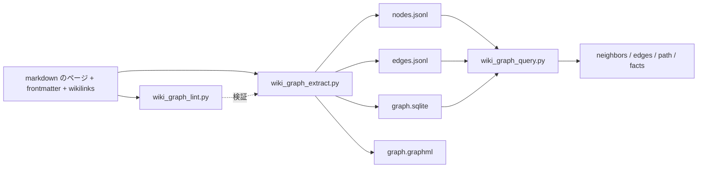

<!-- Adapted from: docs/graph.html (source: skills/llm-wiki/references/graph-workflow.md). -->

# グラフ層 {#graph-layer}

グラフは、markdown の wiki をもとにコンパイルする、任意のインデックスである。正本は markdown のまま、出典を裏づけに持つ型付きの関係を機械的にクエリできるようにする。グラフはいつでもページから作り直せる。

::: info
グラフはオプトイン方式である。`wiki/graph/ontology.yaml` がなければ、その wiki はグラフ層を導入する前の状態である。extract、lint、query を実行したり、オントロジーのファイルをでっち上げたりしてはならない。先に（[`/wiki:graph`](/v3/commands#graph) か [`/wiki:init`](/v3/commands#init) で）グラフ層を初期化するか、グラフなしで進める。
:::

正本は Markdown のページで、以下の成果物はすべて生成物である。いつ削除しても作り直せる。



## グラフが表すもの {#what-the-graph-captures}

extract を実行すると、3種類のエッジができる。

1. **型付きのセマンティックなエッジ**: ページの frontmatter の `graph.relationships[]` で宣言したもの（例: `founded`、`proposed`、`depends_on`）。それぞれに、明示的な `source`（ソースページのスラッグ）、証拠となる引用の `evidence`、`confidence`（high/medium/low）、`status`（current/historical/proposed/disputed/superseded）が付く。抽出スクリプトがこれらを作り出すことはない。
2. **`mentions` エッジ**: 本文の `[[wikilink]]` 1つにつき1本で、ページごとに重複を除き、confidence は `low` になる。目的のページを早く見つけるためのもので、型付きの関係の証拠にはならない。
3. **`sourced_from` エッジと `summarizes_raw` エッジ**: 前者はソースページ以外のページの `sources:` リストからソースページへ、後者はソースページの `raw:` フィールドから raw ファイルへ張られる。

## frontmatter のスキーマ {#frontmatter-schema}

型付きの関係は、ページの frontmatter に書く。

```yaml
graph:
  node_id: person:praney-behl       # 任意。既定は <node_type>:<slug>
  node_type: person                 # 任意。既定はオントロジーの対応付けで決まる
  canonical: true                   # 複数のスラッグが1つのエンティティの別名になっている場合
  aliases: [Praney, praney@example.com]
  relationships:
    - predicate: founded
      object: company:seedblocks
      source: praney-founder-context-dump
      evidence: "Solo technical founder and sole director..."
      confidence: high
      status: current
```

関係の必須フィールドは、`predicate`、`object`、`source`、`evidence`、`confidence`、`status` である。`node_id` の形式は `<node_type>:<slug>` である。

## オントロジー {#the-ontology}

`wiki/graph/ontology.yaml` は、グラフの約束事を定めるファイルである。`node_types[*].maps_from`（ページの `type` や `kind` をどのノードの種類に対応させるか）と、`predicates[*]`（使える述語と、それぞれの `subject_types`、`object_types`、`requires_evidence`。`"*"` はワイルドカード）を宣言する。分野固有の述語を追加するにはオントロジーを編集し、lint を再実行して既存のエッジを検証し直す。

## 型付きエッジと通常の wikilink の使い分け {#typed-edge-vs-plain-wikilink}

特定のソースが関係を明示的に述べていて、証拠を引用でき、その述語が後のクエリで意味を持つ場合は、**型付きエッジ**を追加する。関係が暗黙的な場合、1つの引用に結びつけられない場合、`mentions` エッジにしかならない場合は、通常の **`[[wikilink]]`** を使う。迷ったら wikilink を書く。lint は証拠の欠落を指摘するが、控えめに書いたことをとがめはしない。

## extract、lint、query {#extract-lint-query}

```bash
# まず型付きメタデータを検証する。lint はファイルを編集しない。
uv run --script skills/llm-wiki/scripts/wiki_graph_lint.py wiki/

# nodes.jsonl、edges.jsonl、graph.sqlite、graph.graphml にコンパイルする。
uv run --script skills/llm-wiki/scripts/wiki_graph_extract.py wiki/

# グラフをたどる。
python skills/llm-wiki/scripts/wiki_graph_query.py wiki/ neighbors --node product:konvy
python skills/llm-wiki/scripts/wiki_graph_query.py wiki/ edges    --subject person:stephanie-emmanouel
python skills/llm-wiki/scripts/wiki_graph_query.py wiki/ path     --from person:praney-behl --to product:konvy
python skills/llm-wiki/scripts/wiki_graph_query.py wiki/ facts    --about product:konvy
```

`--json` は lint とクエリの両方のコマンドで使える。同じ操作は [`/wiki:graph`](/v3/commands#graph) スラッシュコマンドでも行える。回答では、必ず wiki ページとその raw ソースを出典にする。グラフはどのページを読めばよいかを教えるもので、グラフそのものは証拠ではない。

## 生成物の扱い {#generated-artifact-policy}

| ファイル | 正本か | 既定の管理方法 |
| --- | --- | --- |
| `ontology.yaml` | 正本。手で編集する | Git で管理する |
| `nodes.jsonl` | 生成物 | 任意。PR でグラフの差分を見たいなら管理する |
| `edges.jsonl` | 生成物 | 任意。上と同じ |
| `graph.sqlite` | 生成物 | 既定で gitignore（大きいバイナリのため） |
| `graph.graphml` | 生成物 | 既定で gitignore |

::: info
グラフの lint と抽出は、PyYAML 6.0.3 に固定したメタデータを持ち、`uv run --script` で実行される。手作業での `pip install` は不要である。グラフのクエリは、Python の標準ライブラリだけを使う。
:::
