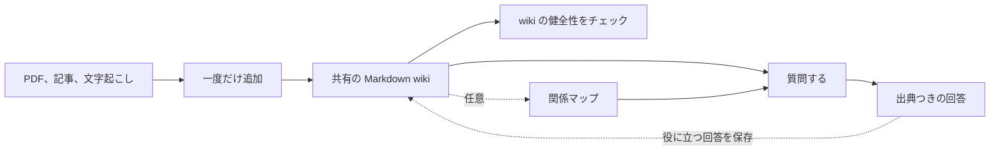

<!-- Adapted from: docs/index.html (source: README.md "What is this?", "Why use it", "Quick start"). -->

# LLM Wiki

PDF、記事、文字起こし、メモを、AI エージェントが検索・引用・更新できる共有 wiki に変える。

AI エージェントは目の前のタスクをこなすのは得意だが、新しいセッションは限られたコンテキストから始まる。LLM Wiki は、エージェントに共有のメモリを与える。このメモリは、すべてのプロジェクトで使う個人用の wiki 1つに置くことも、特定のプロジェクトの中に置くこともできる。

ソースを一度追加すると、エージェントがそれをリンクでつながった Markdown のページに変える。あとでエージェントは、該当するセクションを見つけ、出典つきで回答し、役に立った知見を wiki に書き戻せる。

正本となる情報はすべて、読める Markdown のまま残る。ローカルのセマンティック検索は、いつでも捨てられる SQLite のベクトルインデックスを使い、ホスト型のベクトルデータベースや埋め込みサービスは一切使わない。

## 作った理由 {#why-this-exists}

AI エージェントは、1つのセッションの中ではよい仕事をする。問題は、チャットが終わったあとである。

役に立つ回答が先週の会話に埋もれていることがある。決定事項が会議の文字起こしの中にしかないこともあれば、訂正が issue に書かれたままのこともある。こうしたコンテキストが散らばっていると、次のエージェントは同じファイルを探し、同じ理解をもう一度組み立てなければならない。

LLM Wiki は、その成果を長く残せる置き場所を用意する。ソースはリンクでつながった Markdown になり、回答は出典を保ち、役に立った結論は次のセッションや次のエージェントのために保存できる。

1つの会話より長く知識を残したいときに使う。たとえば、長期にわたる調査、顧客との通話、プロジェクトの決定事項、繰り返し出る質問、複数のエージェントで分担する作業である。一度きりの質問や構造化されたレコードには、チャットや通常のデータベースのほうが向いていることがある。


*ソースは一度追加すれば、あとから出典つきの証拠を取り出せる。役に立った知見を書き戻せば、次のセッションは前回より多くの知識を持って始められる。*

::: tip v3.2.0 の新機能
検証済みのタスクの経験を記録し、再利用できる教訓にまとめ、根拠にリンクしたスキルの変更を評価して、明示的に適用・ロールバックできる。既存のローカル検索と wiki のページは、そのまま使える。詳しくは [学習とスキルの改善](/v3/evolution) と [アップグレード](/v3/upgrade) を参照。
:::

## 仕組み {#how-it-works}

ソースはそれぞれ一度だけ追加する。以降の質問では、raw ファイルから始め直すのではなく、共有 wiki を使う。



## 3ステップで wiki を使い始める {#three-steps-to-a-working-wiki}

1. プロジェクトをまたいで使う個人用の wiki を1つ**初期化**する。

   ```bash
   /wiki:init --global
   ```

   wiki を現在のプロジェクト専用にしたいときは、`--global` を付けずに `/wiki:init` を実行する。

2. 最初のソース（PDF、記事、文字起こし）を**取り込む**。

   ```bash
   /wiki:ingest ~/wiki/raw/your-source.pdf
   ```

3. 蓄積した知識に出典つきで**問い合わせる**。

   ```bash
   /wiki:query What does my wiki say about X?
   ```

Claude Code を使っていない場合も、同じスキルが Codex、Cursor、Pi、OMP などで動く。[はじめに](/v3/getting-started) と [エージェントの対応表](/v3/agents) を参照。

## ドキュメント一覧 {#explore-the-docs}

- **[はじめに](/v3/getting-started)**: 使っているエージェントにインストールし、init、取り込み、クエリ、lint を順に試す。
- **[コマンド](/v3/commands)**: すべての `/wiki:*` スラッシュコマンドの使い方と例。
- **[ワークフロー](/v3/workflows)**: エンドユーザー向けに、取り込み、クエリ、lint を手順ごとに説明する。
- **[検索と取得](/v3/search)**: ローカルのハイブリッド検索、セクション単位の BM25、JSON 形式の証拠、差分更新するキャッシュ。
- **[グラフ層](/v3/graph)**: 出典を裏づけに持つ型付きの関係を扱う、任意のコンパイル済みグラフ。
- **[連携](/v3/integrations)**: チームの UI の中に wiki を表示する Paperclip プラグイン。
- **[エージェント](/v3/agents)**: 対応しているコーディングエージェントと、それぞれのインストール方法。
- **[v3 へのアップグレード](/v3/upgrade)**: プロバイダーを使う構成から、コンテンツを移行せずにローカルのベクトルへ切り替える。

## よくある質問 {#frequently-asked-questions}

### LLM Wiki とは何か {#what-is-an-llm-wiki}

LLM Wiki は、AI エージェントのための共有ナレッジベースである。ソースをリンクでつながった Markdown のページに変えて整理し、あとからの質問に出典つきで答える。

### LLM Wiki は RAG とどう違うのか {#how-is-llm-wiki-different-from-rag}

RAG は通常、質問のたびに raw ドキュメントのチャンクを検索する。LLM Wiki は、まず各ソースを役に立つページに整理する。以降の質問では、リンク、訂正、ソースの履歴を含めて、増えていく知識の集まりを検索する。

### ホスト型の埋め込みサービスやベクトルデータベースは必要か {#does-llm-wiki-require-a-hosted-embedding-service-or-vector-database}

必要ない。既定のセマンティック検索は FastEmbed と sqlite-vec でローカルに動き、正本は Markdown のままである。モデルも追加のパッケージも一切使いたくない場合は、検索スクリプトを Python で直接、`--no-embed` を付けて実行すれば、Python だけで動く BM25 になる。

### LLM Wiki に対応しているコーディングエージェントは {#which-coding-agents-support-llm-wiki}

agentskills.io 互換のスキルは、Claude Code、Codex、Cursor、Gemini CLI、OpenCode、OpenClaw、Pi、OMP、Hermes に対応している。Claude Code では、プラグインを通じて `/wiki:*` スラッシュコマンドも使える。ほかのエージェントでは、同じワークフローを自然言語で呼び出す。[エージェントの対応表](/v3/agents) を参照。

### インストールして使い始めるには {#how-do-i-install-and-start-using-llm-wiki}

使っているエージェントにプラグインかスキルをインストールし、`/wiki:init` を実行する。`/wiki:ingest` でソースを取り込み、`/wiki:query` で出典つきの質問をする。構造と内容の問題を見つけるために、定期的に `/wiki:lint` を実行する。対応しているすべてのエージェントについて、正確なコマンドを [はじめにのガイド](/v3/getting-started) に載せている。

---

LLM Wiki プラグイン、MIT ライセンス。[GitHub のソース](https://github.com/praneybehl/llm-wiki-plugin)。[Karpathy の LLM Wiki gist](https://gist.github.com/karpathy/442a6bf555914893e9891c11519de94f) をもとにしている。セクション単位の取得は Cerebras の [How We Built Our Knowledge Base](https://www.cerebras.ai/blog/how-we-built-our-knowledge-base) を参考にし、ローカルの FastEmbed + sqlite-vec の構成は [Basic Memory](https://github.com/basicmachines-co/basic-memory) と照らし合わせて検証した。

## タスクの経験から学ぶ {#learning-from-task-experience}

任意の改善ワークフローは、[WikiSkill](https://arxiv.org/html/2608.27454v1) を、経験の継続的な記録、パターンの統合、テスト済みのスキル変更という形に取り入れたものである。[取り入れた内容の対応表と、測定した限界](./evolution.md#research-basis-and-adaptation) を参照。現時点の検証では、品質の向上は確認できていない。
