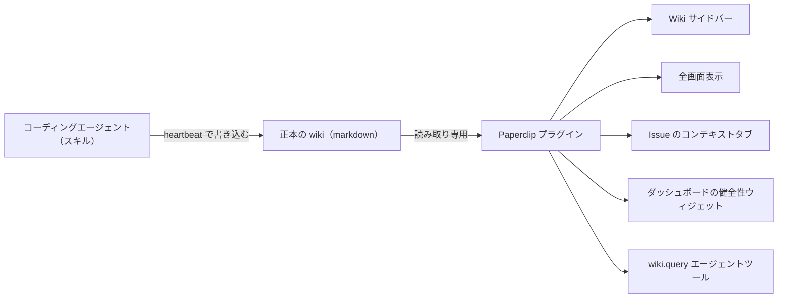

<!-- Adapted from: docs/integrations.html (source: README.md "Integrations", integrations/paperclip/**). -->

# 連携 {#integrations}

スキルは、エージェントの側にインストールするものである。[対応表](/v3/agents) にあるどのエージェントにも入れられる。[Paperclip](https://github.com/paperclipai/paperclip) を使っているチーム向けには、人が使う側の任意のコンパニオンがあり、オペレーターがふだん作業している画面に wiki を表示できる。

## Paperclip: `paperclip-plugin-llm-wiki` {#paperclip-paperclip-plugin-llm-wiki}

[`integrations/paperclip/plugin/`](https://github.com/praneybehl/llm-wiki-plugin/tree/v3.2.0/integrations/paperclip/plugin) にある任意のプラグインは、Paperclip の UI の中に wiki を表示する。表示する画面は5つで、すべて読み取り専用である。

| 画面 | 内容 |
| --- | --- |
| Wiki サイドバー | 種類ごとに wiki を閲覧し、ページを開き、wiki 全体を検索する。 |
| 全画面表示 | 同じブラウザーを全幅で表示する。リンクでつながった複数のページを読むためのもの。 |
| Issue のコンテキストタブ | 開いている issue に関連する wiki ページの上位を、タイトルと説明文に対する BM25 で順位付けして表示する。 |
| ダッシュボードの健全性ウィジェット | ページ数、lint の状態（pass / warn / fail）、リンク密度、インデックス分割の閾値についてのメッセージを表示する。 |
| `wiki.query` エージェントツール | ツール呼び出しで BM25 検索を行う。スキルを直接実行しない、HTTP だけのアダプター向け。 |



コンパニオンをインストールする。

```bash
pnpm paperclipai plugin install paperclip-plugin-llm-wiki
```

::: info
このプラグインは**設計上読み取り専用**で、スキルと組み合わせて使う。スキルが heartbeat のたびに wiki に書き込み、プラグインはそれを Paperclip の中から読む。編集は、これまでどおり heartbeat で動くエージェントか、オペレーターが選んだエディター（Obsidian、Claude Code、SSH での直接編集）で行う。
:::

::: info
プラグインの検索は語彙ベース（BM25）のままである。Paperclip のサンドボックスには API キーを置かないので、[検索と取得](/v3/search) のページで説明しているオプトインのハイブリッド埋め込みは、エージェント側のスクリプトにだけ当てはまる。プラグインのセクション単位の検索は、Python 版と同じ順位付けをそのまま再現しているので、プラグインとエージェントで結果がずれることはない。
:::

## 関連資料 {#further-reading}

- [プラグインのユーザーガイド](https://github.com/praneybehl/llm-wiki-plugin/blob/v3.2.0/integrations/paperclip/plugin/README.md): インストール手順、画面ごとの使い方、設定のリファレンス、エージェントツールの JSON の形式、セキュリティについての注意、トラブルシューティング、FAQ。
- [オペレーター向けの判断ページ](https://github.com/praneybehl/llm-wiki-plugin/blob/v3.2.0/integrations/paperclip/README.md): プラグインを入れるべき場合とスキルだけでよい場合、初回のセットアップ、複数の Company での使い方。
- [v0.1 の設計仕様](https://github.com/praneybehl/llm-wiki-plugin/blob/v3.2.0/integrations/paperclip/SPEC.md): 稼働中の Paperclip プラグイン SDK のソースをそのまま引用して参照している。
- [実現可能性レポート](https://github.com/praneybehl/llm-wiki-plugin/blob/v3.2.0/integrations/paperclip/FEASIBILITY.md): SDK に対するフェーズ 0 の検証。
