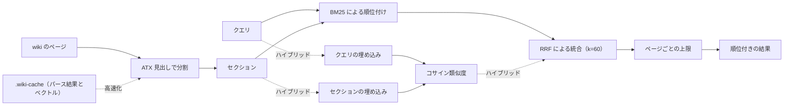

<!-- Source: v3 local hybrid design: FastEmbed, sqlite-vec, BM25/RRF, JSON evidence, and incremental caches. -->

# 検索と取得 {#search-retrieval}

v3.0.0 では、セクション単位のハイブリッド検索がローカルで動き、既定の検索になった。FastEmbed がセマンティック検索用のベクトルを作り、sqlite-vec がそれを保存して順位を付け、BM25 が語の完全一致による精度を保ち、RRF が両方の結果リストを統合する。構造化された `--json` の証拠の行と、内容のハッシュで管理する差分更新のキャッシュは、これまでと変わらない。

検索スクリプトは、インデックスの1行の要約だけでは適切な候補が見つからないときのフォールバックである（[クエリのワークフロー](/v3/workflows#query)を参照）。リポジトリのルートから実行する。

```bash
uv run --script skills/llm-wiki/scripts/wiki_search.py "attention mechanism" --wiki wiki --json
```



## セクション単位の結果 {#section-level-results}

既定（`--granularity section`）では、スクリプトはすべてのページを ATX 見出しで分割し、分割したセクションに BM25 で順位を付ける。1ページから取るセクションは最大 `--per-page` 個（既定は 2）までとし、結果が `--top` 件集まるまで続ける。各セクションのスコアは、タイトル、見出しのパス、本文を対象に計算する。これは文脈を前に付けた BM25 で、長いページの中での一致をより正確にする。

順位付けの定数は v1 から変わっていない（BM25 で `k1=1.5`、`b=0.75`）。Paperclip の TypeScript 移植版もこれとまったく同じ値を使っているので、プラグインとエージェントの結果は常に一致する。

## JSON 形式の証拠の行 {#json-evidence-rows}

`--json` フラグを付けると、機械で読める1つのオブジェクトを標準出力に出力する。エージェントやほかのツールに渡すのに向いている。

```json
{
  "query": "attention mechanism",
  "wiki": "wiki",
  "granularity": "section",
  "mode": "lexical",
  "results": [
    {
      "slug": "attention-mechanism",
      "rel_path": "concepts/attention-mechanism.md",
      "type": "concept",
      "title": "Attention Mechanism",
      "heading_path": ["Attention Mechanism", "Variants"],
      "section_index": 2,
      "score": 8.42,
      "retrievers": ["bm25"],
      "snippet": "...",
      "updated": "2026-01-20",
      "tags": ["attention"],
      "sources": ["attention-paper"],
      "neighbors": {"prev": "Scaled dot-product", "next": "Cross-attention"}
    }
  ]
}
```

| フィールド | 意味 |
| --- | --- |
| `heading_path` | 一致したセクションの見出しの階層（上位の見出しから順に並び、このセクションの見出しで終わる）。ページ単位では空になる。 |
| `section_index` | ページ内でのセクションの位置。ページ単位では `null` になる。 |
| `score` | BM25 のスコア（ハイブリッドモードでは RRF のスコア）。小数点以下 4 桁に丸める。 |
| `retrievers` | この行を見つけた検索器。`["bm25"]`、`["embedding"]`、またはその両方。 |
| `snippet` | セクションの本文。空白をまとめた先頭 400 文字。 |
| `updated`、`tags`、`sources` | frontmatter の値をそのまま使う（ないときは `null` や `[]`）。 |
| `neighbors` | 同じページで隣り合うセクションの見出し（ページの先頭や末尾では `null`）。 |

セマンティック検索の候補は、RRF に入る前に、控えめに設定したコサイン類似度の下限も超える必要がある。これにより、関係のないベクトルの近傍によって、対象外の分野の質問に対しても確かそうに見える結果が返ることを防ぐ。BM25 の完全一致には影響しない。

`--json` を付けないと、結果はこれまでどおりの人が読む形式で表示される。セクションが一致した場合は、見出しのパスを示す `§` の行も表示される。

## ページ単位の順位付け {#whole-page-ranking}

`--granularity page` を指定すると、v1 とまったく同じ方法でページ全体に順位を付ける。v2 より前の動作と、バイト単位で同じ結果になる。ページ単位の行では `heading_path` が空で `section_index` が `null` になり、常に語彙ベースの検索になる（埋め込みはセクション単位でだけ使う）。

```bash
python skills/llm-wiki/scripts/wiki_search.py "attention mechanism" --wiki wiki --granularity page --no-embed --json
```

## フィルター {#filters}

frontmatter のフィルターで結果を絞り込める。フィルターはすべて組み合わせて使える。

```bash
uv run --script skills/llm-wiki/scripts/wiki_search.py "diffusion" --wiki wiki \
  --type concept --tag generative --since 2026-01-01 --top 10 --per-page 3
```

リンクに関する2つのモードは、v1 のテキスト出力のままである。`--backlinks <slug>` は被リンクを、`--top-linked N` は wiki のハブページを見つける。

## パースキャッシュ {#the-parse-cache}

`--cache` フラグを付けると、差分更新するパースキャッシュを使う。これにより、大きな wiki でも、検索のたびにすべてのページをパースし直さずに済む。値を指定しなければ `wiki/.wiki-cache/search-index.json` を使い、パスを指定すればそちらを使う。

```bash
# 既定のキャッシュの場所を使う
uv run --script skills/llm-wiki/scripts/wiki_search.py "attention" --wiki wiki --json --cache

# パスを明示する
uv run --script skills/llm-wiki/scripts/wiki_search.py "attention" --wiki wiki --json --cache /tmp/idx.json
```

各ファイルは、元のバイト列の SHA-256 をキーにして管理する。変わっていないファイルはキャッシュを再利用し、変わったファイルはパースし直し、削除されたファイルはキャッシュから取り除く。キャッシュがない、パースできない、または古いスキーマのものである場合は、最初から作り直し、標準エラー出力に `cache: rebuilding (<reason>)` を1行出力する。キャッシュはアトミックに書き込む。

::: info 結果は必ず同じになる
同じクエリであれば、`--json` の出力は `--cache` の有無にかかわらずバイト単位で同じになる。キャッシュが変えるのは速度だけで、順位は変えない。この不変条件は評価用のハーネスで検証している。
:::

## 既定のローカルハイブリッド検索 {#default-local-hybrid-retrieval}

セクションの検索では、FastEmbed を通じて `BAAI/bge-small-en-v1.5` を使い、384 次元のベクトルを sqlite-vec の仮想テーブルに保存する。BM25 とセマンティック検索の順位は、Reciprocal Rank Fusion（RRF、`k=60`、重みは等しい）で統合する。API キーや外部サービスは使わず、wiki のセクションやクエリのテキストがマシンの外に出ることはない。

スクリプトには、バージョンを固定した [PEP 723](https://peps.python.org/pep-0723/) の依存関係が書かれている。`uv` で実行すれば、プロジェクトの環境を変更せずにそれらのパッケージを使える。

```bash
uv run --script skills/llm-wiki/scripts/wiki_search.py \
  "how does self-attention weigh tokens" --wiki wiki --json --top 5
```

初期化とアップグレードのたびに `setup_wiki.py` が実行される。FastEmbed のモデルのファイルは `~/.cache/llm-wiki/fastembed/` にキャッシュされ（`FASTEMBED_CACHE_PATH` で変更できる）、現在のすべてのセクションが `wiki/.wiki-cache/embeddings.sqlite` に同期される。その後の検索とアップグレードでは、新しいセクションと変更されたセクションだけをベクトル化し、削除されたセクションは取り除く。

ハイブリッドモードでは、JSON の `mode` が `"hybrid"` になる。各行の `retrievers` フィールドを見れば、その行を見つけたのが BM25 か、埋め込みか、その両方かが分かる。

::: warning 失敗しても検索は止まらない
FastEmbed が使えない、モデルの初期化に失敗した、sqlite-vec を読み込めない、といった場合、コマンドは機密情報を含まない警告を標準エラー出力に出し、BM25 にフォールバックして、`mode: "lexical"` で終了コード 0 で終わる。依存パッケージを使わない方法を明示的に選ぶには、PEP 723 による依存関係の解決を使わずに `python skills/llm-wiki/scripts/wiki_search.py "<query>" --no-embed` を実行する。
:::

## キャッシュディレクトリ {#the-cache-directory}

`wiki/.wiki-cache/` には、互いに独立していて、すべて作り直せる2つのインデックスがある。

| ファイル | 用途 |
| --- | --- |
| `search-index.json` | `--cache` で使う、ページとセクションのパース結果のキャッシュ。 |
| `embeddings.sqlite` | セクションの位置情報、内容のハッシュ、sqlite-vec のベクトル。 |

どちらも gitignore の対象で、削除してかまわない。足りないものは、次のクエリのときに作り直される。モデル、次元数、ベクトルのスキーマが変わったときも、`embeddings.sqlite` は自動的に作り直される。旧来のプロバイダー用のキャッシュである `embeddings.jsonl` は無視されるので、削除してよい。
