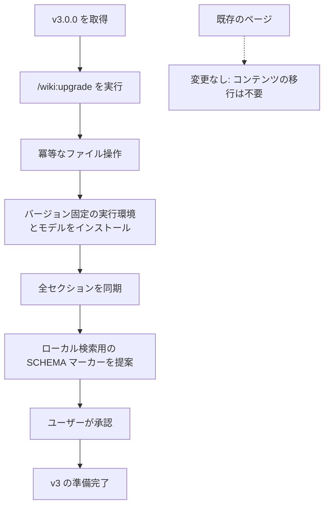

<!-- Adapted from: the v3.0.0 local semantic retrieval design and commands/wiki/upgrade.md. -->

# v3.2.0 へのアップグレード {#upgrade-to-v3-2-0}

v3.2.0 では、任意で使える経験の記録と、評価済みのスキル改善が加わった。既存の wiki、frontmatter、CLI のフラグはそのまま使えるので、マイナーリリースとしている。バックグラウンドで動く最適化は有効にならない。

インストール済みのプラグインまたはスキルを更新し、設定済みの wiki に対して `/wiki:upgrade` を実行する。既存の実行環境のセットアップは、引き続き必須である。アップグレードでは、`.experience-template.json`、`.pattern-template.md`、`.evolution/README.md` を、ない場合にだけ追加する。カスタマイズしたファイルと SCHEMA.md はそのまま残る。任意の `## Skill evolution` スキーマセクションを、レビュー用に提案する。

検証済みのタスクの経験には `/wiki:learn` を使い、根拠にリンクした改善案の作成と、測定にもとづく採用には `/wiki:evolve` を使う。アップグレードの途中で評価やスキルの置き換えが行われることはない。`.evolution/` は、いつでも捨てられる `.wiki-cache/` と違って長く残す履歴なので、バックアップしておく。ランナーの仕様、パイロットスイート、推論の予算、ロールバックについては [学習とスキルの改善](/v3/evolution) を参照。

Paperclip 連携の v0.5.3 では、実験のスナップショットが閲覧・検索・健全性の画面に表示されないようにしている。改善中の wiki と一緒に使う場合は、この連携を別途更新する。

## v3.0 より前からのアップグレード {#upgrading-from-before-v3-0}


v3.0.0 では、プロバイダーを使う埋め込みを廃止し、既定の検索をローカルの FastEmbed + sqlite-vec に切り替えた。既存の Markdown には手を付けず、変わるのは、いつでも捨てられるベクトルインデックスだけである。

::: info コンテンツの移行は不要
ページと frontmatter の形式は変わっていない。古い `embeddings.jsonl` キャッシュは無視されるので、削除してかまわない。`/wiki:upgrade` がローカルで `embeddings.sqlite` を作り、現在の全セクションを同期する。
:::



## メジャーバージョンにした理由 {#why-it-s-a-major-version}

以前のセクション検索は、プロバイダーを設定しない限り語彙ベースのままだった。v3.0.0 からは、ローカルのモデルと sqlite-vec のインデックスを初期化して使う。データの扱いは完全にローカルに限られ、プロバイダー用の古い環境変数と承認フラグは削除された。`python wiki_search.py "<query>" --no-embed` で直接実行すれば、依存パッケージを使わない BM25 を引き続き使える。

## アップグレードの手順 {#the-upgrade}

1. **最新のリリースを取得する。** プラグインは、インストールしたときと同じ方法で更新する。Claude Code ならマーケットプレイスからのインストールをやり直し、スキルだけを入れたエージェントなら `npx skills add` を再実行する。
2. **アップグレードを実行する。** Claude Code では次を実行する。

   ```bash
   /wiki:upgrade
   ```

   直接実行する場合は、インストール済みのスクリプトと、選んだベースディレクトリを別々に渡す。プロジェクトの wiki の場合:

   ```bash
   python "${CLAUDE_PLUGIN_ROOT}/skills/llm-wiki/scripts/init_wiki.py" "<absolute-project-root>" --upgrade
   ```

   標準の個人用グローバル構成の場合:

   ```bash
   python "${CLAUDE_PLUGIN_ROOT}/skills/llm-wiki/scripts/init_wiki.py" "<absolute-home-directory>" --wiki-dir wiki --raw-dir wiki/raw --upgrade
   ```

   スキルだけをインストールしている場合は、`${CLAUDE_PLUGIN_ROOT}/skills/llm-wiki` を、そのエージェントにインストールした `llm-wiki` スキルのディレクトリに置き換える。プラグインやスキルのディレクトリをベースディレクトリにしてはならない。

   > **期待する結果**: 冪等なファイル操作なので、既存のページには手が加わらない。続いて実行環境のセットアップが、固定した依存パッケージのバージョン、モデル、ページ数、セクション数、ベクトルインデックスのパスとともに `"status": "ready"` を返す。そのあとで、コマンドが SCHEMA に欠けているマーカーを報告する。
3. **SCHEMA.md のマージを承認する。** 現在のテンプレートにあるローカルのセマンティック検索用の行を、既存の `## Retrieval` セクションに追加する。SCHEMA.md はユーザーと一緒に改訂していくものなので、黙って変更されることはない。

アップグレードは何度実行しても同じ結果になる。既存のコンテンツは変わらず、依存パッケージとモデルは確認だけされ、変わったベクトルと欠けているベクトルだけが作られる。

## ユーザーにとって変わること {#what-changes-for-you}

- **既存のページに変更は要らない。** `wiki/` の下にある正本は、何も書き換えられない。
- **セクション検索の既定は、ローカルのハイブリッド検索になる。** FastEmbed + sqlite-vec によるセマンティックな順位付けを、BM25 と統合する。依存パッケージを使わない語彙ベースの検索にするには、スクリプトを Python で直接、`--no-embed` を付けて実行する。ページ単位で順位を付けるには `--granularity page` を使う。
- **アップグレードで必要なものがすべて入る。** このコマンドは、バージョンを固定した FastEmbed、sqlite-vec、PyYAML を `uv` で解決し、固定したモデルがなければダウンロードし、パースキャッシュを作り、現在の全セクションをベクトル化する。
- **`wiki/.wiki-cache/` は作り直せる。** `search-index.json` と `embeddings.sqlite` は gitignore されており、削除してかまわない。旧来の `embeddings.jsonl` は無視される。
- **プロバイダーの設定はもう要らない。** API キー、エンドポイント、データ送信の承認、クエリごとの課金は一切ない。

::: warning
wiki がまだない場合、アップグレードするものはない。代わりに [`/wiki:init`](/v3/getting-started) を実行する。
:::
