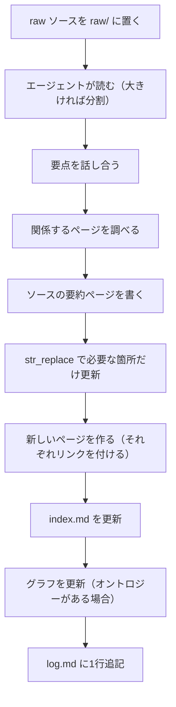
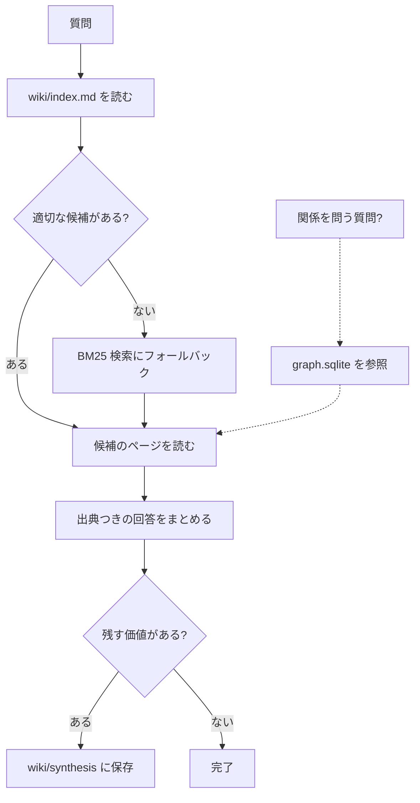

<!-- Adapted from: docs/workflows.html (source: skills/llm-wiki/references/{ingest-workflow,query-workflow,lint-workflow}.md). -->

# ワークフロー {#workflows}

wiki の操作は3つある。ソースの[取り込み](#ingest)、蓄積した知識への[クエリ](#query)、健全性を保つための [lint](#lint) である。ここでは、それぞれで何が起きるかを利用者の立場から説明する。

::: info
これらの操作は、コマンド（`/wiki:ingest`、`/wiki:query`、`/wiki:lint`）でも自然言語でも実行できる。記録の管理はエージェントが行う。利用者の役目は、ソースを選び、いくつかの質問に答え、編集を承認することである。
:::

## ソースを取り込む {#ingest}

新しいソースが来たときの手順は次のとおり。各ステップが次のステップのためのコンテキストを作るので、順序が重要である。



1. **raw ソースを置く。** 内容が分かるようにスラッグ化したファイル名（小文字、ハイフン区切り、元の拡張子）で、ファイルを `raw/` に置く。Web の記事は `.md`、PDF は `.pdf`、文字起こしは `.md` か `.txt` にする。このスラッグが、ソースの要約ページのスラッグになる。
2. **エージェントがソースを読む。** 短いソースは一度に読む。長いソース（約 30 ページを超える論文、書籍の章、数時間分の文字起こし）はセクションごとに分割して読むので、wiki の作業でコンテキストウィンドウがあふれることはない。
3. **要点を話し合う。** エージェントが、目立った点、意外だった点、既存のページとつながる点を3〜4文で示す。利用者の反応（「手法は飛ばして、結果だけでいい」「これは X のページと矛盾するので、フラグを立てて」）が編集の内容を左右する。人手を介さないバッチモードではこのステップをスキップし、編集は控えめにする。
4. **エージェントが関係するページを調べる。** インデックスと候補のページを読み、更新するページ、新しく作るページ、フラグを立てる矛盾の一覧を作る。この調査によって、ページの重複を防ぐ。
5. **ソースの要約ページを書く。** 保存先は `wiki/sources/` である。主な主張、手法、結論、未解決の問いをまとめ、最後に `[[wikilinks]]` を並べた「Where this fits」セクションを置く。ソース全体を言い換えたものではなく、要約である。
6. **関係するページを、必要な箇所だけ更新する。** ページ全体を書き直さず、`str_replace` を使う。裏づけが得られたら出典を追加する。矛盾があれば、両方のソースを挙げた「Contradictions」の注記を目立つように付ける（黙って上書きすることはない）。
7. **新しいページを作る。** ページを作るに値する新しいエンティティやコンセプトがあれば、それぞれ frontmatter、本文、少なくとも1つの被リンクを付けて作る。どこからもリンクされていないページは、lint の検出結果にとどまらず、バグとして扱う。
8. **インデックスを更新する。** 新しいページごとに1行の項目を追加する。`index.md` が 300 行を超えたら、分割する時期である。[スケーリングの閾値](/v3/commands#stats)を参照。
9. **グラフ層を更新する。** 更新するのは、`wiki/graph/ontology.yaml` があり、ソースが型付きのエッジを明示的に裏づけている場合だけである。[グラフ層のガイド](/v3/graph)を参照。
10. **ログに1行追記する。** エージェントは、更新したページ、作成したページ、フラグを立てた矛盾、追って調べる価値のある点を報告する。

## wiki にクエリする {#query}

目的は、wiki をもとに出典つきで質問に答え、残す価値のある回答はシンセシスのページとして wiki に保存することである。



1. **最初にインデックスを読む。** 必ず `wiki/index.md`（または該当する分割ファイル）から始める。1ページにつき1行の簡潔な要約があれば、たいていはそれで候補を見つけられる。
2. **候補のページを絞り込む。** 候補は少数に絞る。1つの質問に答えるために 30 ページを読むのは力任せのやり方である。インデックスの要約だけで絞り込めない場合は、エージェントがローカルのハイブリッド検索を実行する。

   ```bash
   uv run --script skills/llm-wiki/scripts/wiki_search.py \
     "your query terms" --top 10 --json
   ```

   FastEmbed によるセマンティック検索の順位と BM25 の順位は、ローカルで統合される。絞り込むには `--type concept`、`--tag <tag>`、`--since YYYY-MM-DD` を付ける。依存パッケージを使わない語彙ベースの検索にするには、`uv run --script` の形ではなく `python skills/llm-wiki/scripts/wiki_search.py "your query terms" --no-embed` を実行する。詳しくは[検索と取得](/v3/search)を参照。
3. **関係を問う質問ではグラフを参照する。** 「X とつながっているものは？」「Y を提案したのは誰？」「A → B の経路をたどって」のような質問で、`graph.sqlite` がある場合である。グラフは読むページを選ぶために使い、それだけを証拠にすることはない。
4. **候補のページを全文読む。** 有望な `[[wikilinks]]` はたどるが、すべてのリンクを再帰的に追いかけることはしない。
5. **必要に応じて被リンクを調べる。** 「X はどこで言及されているか」という質問では、ページそのものより被リンクのほうが役に立つことが多い。

   ```bash
   python skills/llm-wiki/scripts/wiki_search.py "" --backlinks <slug>
   ```
6. **回答をまとめる。** エージェントは自分の言葉で回答を書き、`[[wikilink]]` で出典を示す。矛盾があれば、どちらか一方を選んで片付けず、矛盾をそのまま示す。wiki に関係する内容がなければ、そうはっきり伝え、取り込むとよいソースを提案する。話をでっち上げることはない。
7. **wiki への保存を提案する。** 回答が新しいつながりを見いだすものであれば、エージェントは `wiki/synthesis/` への保存を提案する。保存しておけば、次に関連する質問が来たときに役立つ。ちょっとした調べものなら断ってよい。

## lint で健全性を保つ {#lint}

lint は定期的な健全性チェックで、操作のたびではなく、決まった頻度で実行するのがよい。スクリプトによる構造のチェックと、エージェントがページを読む内容のチェックに分かれる。

1. **構造の lint を実行する。**

   ```bash
   python skills/llm-wiki/scripts/wiki_lint.py wiki/
   ```

   孤立ページ、リンク切れの wikilink、大きすぎるページ、frontmatter の問題、更新の止まったページ、重複したスラッグが報告される。グラフ層があれば `wiki_graph_lint.py` も実行される。
2. **エージェントと一緒に検出結果を仕分ける。** 検出結果にはそれぞれ修正案が付く。孤立ページは適切な親ページからリンクする、リンク切れは直すか削除する、大きすぎるページは分割する、欠けている frontmatter は追加する、更新の止まったページは更新する、重複したスラッグは統合する、といった案である。修正は1件ずつ利用者が承認し、黙って適用されるものはない。
3. **内容のチェックではページを読む。** エージェントは、最近更新された約 10 ページと、もっとも多くリンクされているハブページを読み、古いページとの矛盾、ページ内の食い違い、あちこちで言及されているのに専用のページがないコンセプトを探す。ハブページは次のコマンドで見つかる。

   ```bash
   python skills/llm-wiki/scripts/wiki_search.py "" --top-linked 10
   ```
4. **足りない点を示す。** 多くのページに出てくるのに専用のページがない名前は、独立したページにする候補である。

   ```bash
   python skills/llm-wiki/scripts/wiki_lint.py wiki/ --suggest-pages
   ```
5. **インデックスを更新する。** 追加、名前の変更、削除のあったページについてインデックスを更新し、まとめの行を `log.md` に1行追記する。

::: info 頻度
妥当な既定値は、構造の lint を取り込み5回ごと、内容の lint を毎週または取り込み 20 回ごと、足りない点の洗い出しを毎月である。lint のレポートが仕分けられる速さを超えて増えていくなら、lint の頻度を上げるか、スキーマを見直す時期である。
:::

## 学習とスキルの改善 {#learn-and-evolve}

完了したタスクは、`/wiki:learn` を使って、変更不可の経験のソースと、再利用できるコンセプトのパターンにできる。`/wiki:evolve` は、範囲を区切った学習とパターンの統合を行い、スキル全体に対する変更を提案し、検証用のデータで選定し、固定した選定結果を独立した最終テストで測定する。失敗した実験は残し、承認された変更は明示的に適用またはロールバックする。通常の事実情報としての wiki の利用は、そのまま続けられる。ワークフロー全体、実行できるパイロット、評価の範囲については、[学習とスキルの改善](/v3/evolution)を参照。
