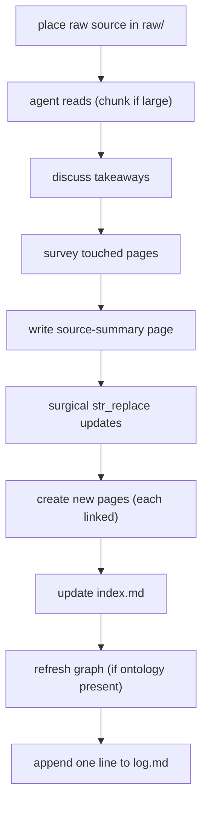
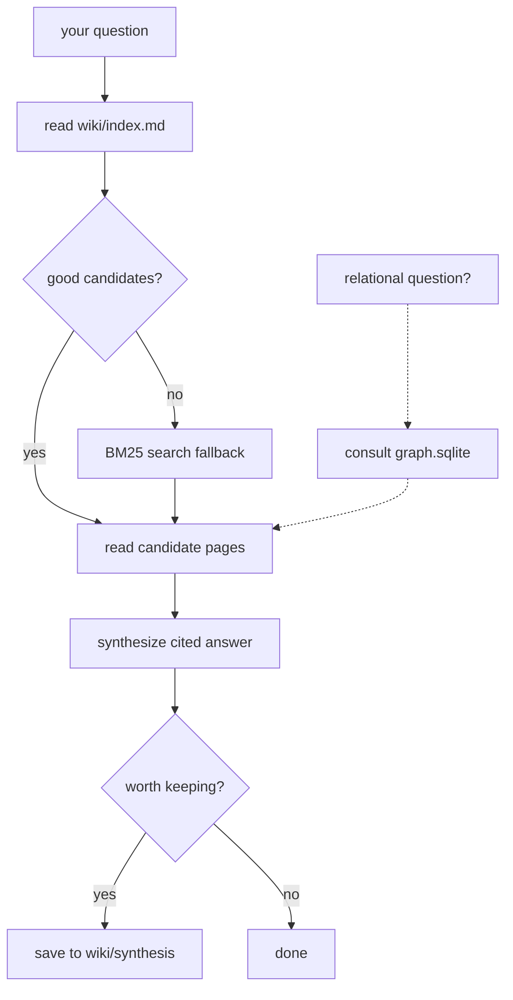

<!-- Adapted from: docs/workflows.html (source: skills/llm-wiki/references/{ingest-workflow,query-workflow,lint-workflow}.md). -->

# ワークフロー {#workflows}

wiki の操作は3つある。ソースの[取り込み](#ingest)、蓄積した知識への[クエリ](#query)、健全性を確かめる [lint](#lint) である。ここでは、それぞれで何が起きるかをユーザーの視点から説明する。

::: info
これらの操作は、コマンド（`/wiki:ingest`、`/wiki:query`、`/wiki:lint`）でも自然な言葉でも実行できる。記録の管理はエージェントが行う。ユーザーの役目は、ソースを選び、いくつかの質問に答え、編集を承認することである。
:::

## ソースを取り込む {#ingest}

新しいソースが届いたら、次の手順で取り込む。各手順が次の手順に必要な文脈を作るので、順序が重要である。



1. **raw ソースを置く。** ファイルを `raw/` に置く。ファイル名は内容が分かるものをスラッグ化する（小文字、ハイフン区切り、元の拡張子）。Web の記事は `.md`、PDF は `.pdf`、文字起こしは `.md` か `.txt` にする。このスラッグが、ソースの要約ページのスラッグになる。
2. **エージェントが読む。** 短いソースは一度に読む。長いソース（約 30 ページを超える論文、書籍の章、数時間分の文字起こし）はセクションごとに分割して読み、wiki の作業でコンテキストウィンドウがあふれないようにする。
3. **要点を話し合う。** エージェントが、目立った点、意外だった点、既存のページとつながる点を3〜4文で示す。ユーザーの反応によって編集の内容が変わる（「手法は省いて、結果だけでよい」「これは X のページと矛盾するので、指摘しておいて」など）。人が介在しないバッチモードではこの手順をスキップし、編集は控えめにする。
4. **エージェントが関係するページを調べる。** インデックスと候補のページを読み、更新するページ、新しく作るページ、指摘すべき矛盾の一覧を作る。この調査によって、重複したページができるのを防ぐ。
5. **ソースの要約ページを書く。** `wiki/sources/` に、主な主張、手法、結論、未解決の問いを書き、最後に `[[wikilinks]]` を並べた「Where this fits」セクションを置く。ソース全体を言い換えたものではなく、要約である。
6. **関係するページを必要な箇所だけ更新する。** 全体を書き直すのではなく、`str_replace` を使う。裏づけが得られた内容には出典を加える。矛盾する内容には、両方のソースを示した「Contradictions」の注記を目立つように付ける（黙って上書きすることはない）。
7. **新しいページを作る。** ページを作るに値する新しいエンティティやコンセプトについて作り、どのページにも frontmatter、本文、少なくとも1つの被リンクを付ける。どこからもリンクされていないページは、lint の検出結果にとどまらず、バグとして扱う。
8. **インデックスを更新する。** 新しいページごとに1行を追加する。`index.md` が 300 行を超えたら、インデックスを分割する時期である。[スケーリングの閾値](/commands#stats)を参照。
9. **グラフ層を更新する。** `wiki/graph/ontology.yaml` があり、ソースが型付きエッジを明示的に裏づけている場合に限る。[グラフ層のガイド](/graph)を参照。
10. **ログに1行追記する。** エージェントは、何をしたかをユーザーに伝える。更新したページ、作成したページ、指摘した矛盾、追って調べる価値のある点を報告する。

## wiki にクエリする {#query}

目的は、ユーザーの質問に wiki をもとに出典つきで答えることと、残す価値のある回答をシンセシスのページとして wiki に保存することである。



1. **最初にインデックスを読む。** 必ず `wiki/index.md`（または該当する分割済みのインデックス）から始める。ページごとに簡潔な要約が1行あれば、たいていはそれで候補を見つけられる。
2. **候補のページを絞り込む。** 候補は短く、厳選した一覧にする。1つの質問に答えるために 30 ページを読むのは力任せのやり方である。インデックスの要約だけでは候補を絞れない場合、エージェントはローカルのハイブリッド検索を実行する。

   ```bash
   uv run --script skills/llm-wiki/scripts/wiki_search.py \
     "your query terms" --top 10 --json
   ```

   FastEmbed によるセマンティック検索の順位と BM25 の順位を、ローカルで統合する。絞り込むには `--type concept`、`--tag <tag>`、`--since YYYY-MM-DD` を付ける。依存パッケージを使わない語彙ベースの検索にしたい場合は、`uv run --script` の形ではなく `python skills/llm-wiki/scripts/wiki_search.py "your query terms" --no-embed` を実行する。詳しくは[検索](/search)を参照。
3. **関係を問う質問ではグラフを参照する。** 「X とつながっているものは？」「Y を提案したのは誰？」「A → B の経路をたどって」のような質問で、`graph.sqlite` がある場合に使う。グラフは読むページを選ぶために使い、それだけを証拠にすることはない。
4. **候補のページを読む。** ページは全体を読み、有望な `[[wikilinks]]` をたどる。すべてのリンクを再帰的に追いかけることはしない。
5. **必要ならバックリンクを調べる。** 「X はどこで言及されているか」という質問では、ページそのものより、そのページへの被リンクのほうが役に立つことが多い。

   ```bash
   python skills/llm-wiki/scripts/wiki_search.py "" --backlinks <slug>
   ```
6. **回答をまとめる。** エージェントは自分の言葉で回答を書き、`[[wikilink]]` で出典を示す。矛盾がある場合は、どちらか一方を選んで片づけず、矛盾をそのまま示す。wiki に関係する内容がなければそうはっきり伝え、取り込むとよいソースを提案する。話をでっち上げることはない。
7. **wiki への保存を提案する。** 回答が新しいつながりを見いだしたものであれば、エージェントは `wiki/synthesis/` への保存を提案する。保存しておけば、次に関連する質問が来たときに役立つ。ちょっとした調べものなら断ってよい。

## lint で健全性を確かめる {#lint}

定期的に行う健全性のチェックである。操作のたびに行うより、一定の間隔で行うのがよい。構造の確認（スクリプトが行う）と、内容の確認（エージェントがページを読んで行う）に分かれる。

1. **構造の lint を実行する。**

   ```bash
   python skills/llm-wiki/scripts/wiki_lint.py wiki/
   ```

   孤立ページ、リンク切れの wikilink、大きすぎるページ、frontmatter の問題、更新の止まったページ、重複したスラッグを報告する。グラフ層があれば、`wiki_graph_lint.py` も実行される。
2. **検出結果をエージェントと一緒に仕分ける。** 検出結果には、それぞれ修正案が付く。孤立ページを適切な親ページからリンクする、リンク切れを直すか削除する、大きすぎるページを分割する、欠けている frontmatter を追加する、更新の止まったページを更新する、重複したスラッグをマージする、といったものである。修正はユーザーが1件ずつ承認し、黙って適用されるものはない。
3. **内容の確認でページを読む。** エージェントは、最近更新された約 10 ページと、もっとも多くリンクされているハブページを読み、古いページとの矛盾、ページ内の食い違い、あちこちで言及されているのに専用のページがないコンセプトを探す。ハブページは次のコマンドで見つける。

   ```bash
   python skills/llm-wiki/scripts/wiki_search.py "" --top-linked 10
   ```
4. **足りていない点を挙げる。** 多くのページに出てくるのに専用のページがない名前は、独立したページにする候補である。

   ```bash
   python skills/llm-wiki/scripts/wiki_lint.py wiki/ --suggest-pages
   ```
5. **インデックスを更新する。** 追加、名前変更、削除したページについてインデックスを更新し、`log.md` に要約を1行追記する。

::: info 頻度
妥当な既定値は、構造の lint を取り込み 5 回ごと、内容の lint を毎週または取り込み 20 回ごと、足りない点の洗い出しを毎月である。lint のレポートが仕分けられる速さより早く増えていくなら、lint の頻度を上げるか、スキーマを見直す時期である。
:::

## 学習とスキルの改善 {#learn-and-evolve}

完了したタスクは、`/wiki:learn` で変更不可の経験のソースと、再利用できるコンセプトのパターンにできる。`/wiki:evolve` は、回数に上限のある学習とパターンの統合を行い、スキル全体の変更を提案し、検証の結果で候補を選び、固定した選定結果を独立した最終テストで測定する。失敗した実験も残し、承認された変更を明示的に適用またはロールバックする。通常の事実情報としての wiki はそのまま使える。ワークフロー全体、実行できるパイロット、評価の範囲については、[学習とスキルの改善](/evolution)を参照。
