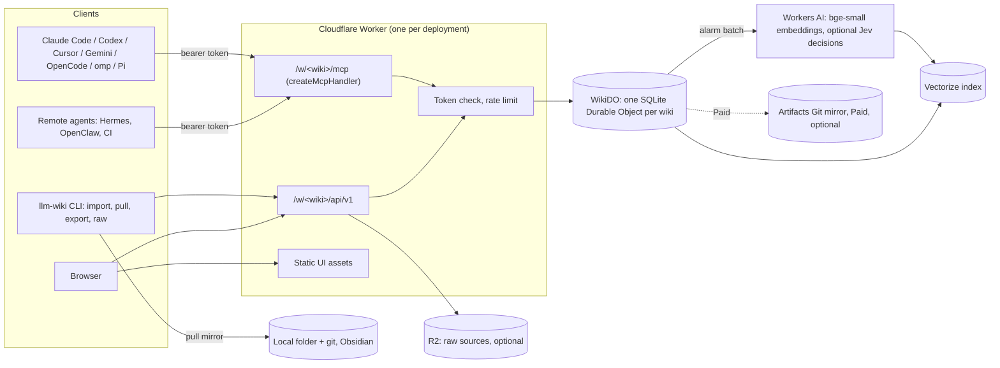

# LLM Wiki v4 の計画: Cloudflare 上のホスト型 wiki、Paperclip の削除、任意の判定モデル

状況: 2026-10-29 に方向性が承認された。Cloudflare を優先し、ワンクリックでのデプロイを主要な要件とする。フェーズ 0 はまだ始まっていない。コードはまだ書いていない。
日付: 2026-10-29。omp エージェントが Praney のために作成した。
事実は 2026-10-29 に確認した。各セクションに出典を挙げる。`[INFERENCE]` は、どの出典にも書かれていない結論であることを示す。

## 1. 要約

- 主要な要件は、ワンクリックでのデプロイである。「Deploy to Cloudflare」ボタンですべてのリソースを作成し、そのあとユーザーが管理用のシークレットを1つ入力する。
- Markdown を正本のデータとして維持する。1つの wiki を1つの SQLite Durable Object（DO）に置く。DO はすべての書き込みを順番に処理するので、更新が失われることはない。
- エージェントは1つの Worker を通じて接続する。Worker は MCP（Streamable HTTP）、JSON API、読み取り専用の Web UI を提供する。
- エージェントごとに専用の Bearer トークンを発行する。主要な5つの MCP クライアントはどれも、固定の `Authorization` ヘッダーを送れる。claude.ai と ChatGPT のコネクターには、同じ Worker 内の OAuth で対応する。
- 検索はハイブリッドのままにする。キーワード側は SQLite FTS5 が担い、ベクトル側は Workers AI の `bge-small-en-v1.5` と Vectorize が担う。両者を RRF で統合する。
- この設計は Workers Free プランで動く。Workers Paid（$5）では、CPU の余裕、Git ミラー（Artifacts）、追加のストレージが使える。
- ローカルモード（ディスク上のファイルと Python スクリプト）は残す。ホストモードは2つ目のバックエンドであり、置き換えではない。
- v4.0.0 で Paperclip 連携を削除する。その TypeScript の検索、lint、stats、リーダーのコードは新しいサーバーに移す。
- 判定モデルは v4.0 に含める。任意で使うもので、既定では無効にする。1つのクライアントが、共通の `/v1/systemone` スキーマで通信する。バックエンドは、ローカルの Liquid d1-2B、ホスト型の TypeSafe Jev（直接または Workers AI 経由）、Liquid API である。
- 各閾値は、ラベル付きの評価で決める。ベースラインを上回らないチェックには「experimental」のラベルを付けたままにする。

## 2. 調査結果

### 2.1 バージョン

| 項目 | 状態 | 証拠 |
|---|---|---|
| リポジトリ `llm-wiki-plugin` | v3.2.0。`main` = `origin/main` = `32014c8`。 | `git rev-parse HEAD`、`git ls-remote` |
| skills.sh のコピー `~/.agents/skills/llm-wiki` | v3.2.0。リポジトリと同じファイル。 | `.skill-lock.json` の ref が `v3.2.0`。`diff -rq` で差分なし |
| そのコピーへのシンボリックリンク | `~/.claude/skills`、`~/.omp/agent/skills`、`~/.pi/agent/skills`、`~/.openclaw/skills` | `ls -la` |
| Claude Code プラグイン | 3.2.0 のキャッシュとマーケットプレイスのクローンが `32014c8`。リポジトリと同じファイル。 | `installed_plugins.json`、`diff -rq` |
| `~/wiki` のスキーマ | v3.2.0 のマーカーがすべてある。`.experience-template.json`、`.pattern-template.md`、`.evolution/` がある。 | `init_wiki.py` の `SCHEMA_SECTION_MARKERS` |
| `~/wiki` の実行環境 | ハイブリッド検索は動く。2,718 セクションのうち 493 に最新のベクトルがなかった。検索でそれらを 34 秒かけてベクトル化した。 | `wiki_search.py` の実行 |

古いベクトルが残っていたことから、実際の問題が分かる。エージェントはページを編集するが、ローカルのインデックスは次の検索のときにしか更新されない。

### 2.2 自分が作ったものではない項目（変更していない）

- `~/wiki` に、コミットされていない変更済みのファイルが 20 個以上ある。
- リポジトリには、変更された `AGENTS.md`、追跡されていない `output/` フォルダー、追跡されていない `research/proposal-typed-decision-layer.md` がある。
- CHANGELOG には、v3.1.0 で `paperclip-plugin-llm-wiki` v0.5.2 を npm に公開したとある。現在、npm レジストリはこのパッケージに 404 を返す。npm での非推奨化は必要ない。

### 2.3 Praney の wiki の規模（見積もりの入力）

| 指標 | 値 |
|---|---|
| ページ | 317 |
| Markdown（`raw/` と `log.md` を除く） | 3.2 MB |
| セクション | 2,718 |
| コンテンツページ内の wikilink | 2,911 |
| `log.md` | 396 KB |
| `raw/` | 1,122 ファイル、602 MB。2 MB を超えるファイルが 55、メディアファイルが 269、PDF が 14 |

## 3. 目標と対象外

目標:

1. 多数のマシン上の多数のエージェントが、1つの wiki を読み書きする。更新は失われない。
2. 誰でも、自分の Cloudflare アカウントにサーバーをデプロイできる。Free プランで動き、Paid では余裕が増える。
3. Markdown を正本のままにする。いつでもファイルへの完全なエクスポートができる。
4. 現在のユーザーには、ローカルモードが変更なしで動き続ける。
5. すべての書き込みについて、どのエージェントが、いつ、なぜ行ったかを記録する。
6. 任意の判定モデルは、測定で効果が示された箇所でだけ使う。

v4.0 の対象外:

- Praney が運用するマルチテナントの SaaS。
- ブラウザーでのリアルタイムの共同編集。
- Cloudflare 上で動く Python スクリプト（Containers は Paid 限定）。
- 双方向のファイル同期。v4.0 は pull 専用のミラーを持つ。

## 4. アーキテクチャ



### 4.0 ワンクリックでのデプロイ（主要な要件）

すべての設計上の選択は、次のテストに合格しなければならない。ユーザーがボタンをクリックし、シークレットを1つ入力すると、動く wiki が手に入ること。

Deploy ボタンについての事実（[ドキュメント](https://developers.cloudflare.com/workers/platform/deploy-buttons/)）:

- リポジトリをユーザーの GitHub または GitLab のアカウントにクローンし、バインディングを作成し、Workers Builds でデプロイする。
- KV、D1、R2、Vectorize、Durable Objects、Workers AI、Queues、Secrets Store のバインディングを作成できる。
- デプロイするのは1つの Worker である。複数の Worker を一緒にはデプロイできない。
- リポジトリは公開されていなければならない。サブフォルダーは、それだけで完結していなければならない。
- `.dev.vars.example` で宣言したシークレットの入力を求める。

これらの事実から導かれる規則:

| 規則 | 設計への反映 |
|---|---|
| Worker は1つ | MCP、OAuth、JSON API、静的な UI、`WikiDO` クラスをすべて1つの Worker に入れる。 |
| ボタンが作成できるバインディングだけを使う | DO、Vectorize、Workers AI、R2、KV（OAuth 用）だけを使う。D1 は使わない。Artifacts は、デプロイ後に行う任意の Paid の手順とする。 |
| 手作業のセットアップ手順はなし | Vectorize のメタデータインデックスは使わない（ボタンで作成する方法は見つからなかった）。検索のフィルターは DO 内で実行する。DO は自身の SQLite テーブルをコードで作成する。 |
| シークレットは1つ | 入力を求めるのは `ADMIN_TOKEN` だけである。GitHub OAuth アプリや Access のセットアップは必要ない。 |
| サブフォルダーだけで完結 | ホスト型のコードはすべて `server/` に置く。`server/` の外のファイルは import しない。 |

クリック後の流れ:

1. ボタンが Worker、DO、Vectorize のインデックス、R2、KV、Workers AI のバインディングを作成し、`ADMIN_TOKEN` の入力を求める。
2. ユーザーは `https://<worker>.workers.dev/setup` を開き、`ADMIN_TOKEN` でサインインする。
3. セットアップページで最初の wiki を作成し、エージェントごとにトークンを1つ作り、クライアントごとの MCP の設定文を表示する。
4. 任意: `llm-wiki import` で既存のローカルの wiki を移す。

ボタンを使わないユーザー向けの CLI の手順: `npm create cloudflare@latest -- --template=praneybehl/llm-wiki-plugin/server`。

フェーズ 0 で確かめる未解決の項目:

- R2 をまだ有効にしていない新しい Free アカウントでも、ボタンは動くか。R2 の登録には決済の手順がある。失敗する場合は、R2 なしの構成用に2つ目のボタンを公開する。
- Free での DO の CPU の上限は 10 ms か。ドキュメントの記述が食い違っている。

### 4.1 wiki ごとに1つの Durable Object を使う理由

- DO は一度に1つのリクエストを処理する。ストレージの呼び出しはそれぞれトランザクションになる。これにより、複数ページのアトミックなコミットができ、更新が失われない。
- SQLite の DO は Free プランで使える。DO の SQLite では FTS5 が使える。
- DO には 30 日間のポイントインタイムリカバリーがある。
- 1つの DO が1つの wiki を持つ。1つのデプロイで、個人用の wiki 1つとプロジェクトごとの wiki のように、複数の wiki を持てる。

選ばなかった選択肢:

| 選択肢 | 正本のストアとして使わない理由 |
|---|---|
| Git を正本にする（GitHub または Artifacts） | 同時に push すると non-fast-forward エラーが起きる。`index.md` の分割と `log.md` でマージの競合が起きる。シェルを持たないリモートのエージェントは Git を使えない。Artifacts は Paid 限定で、オープンベータである。Artifacts のバインディングはファイルを書けないので、書き込みには isomorphic-git が必要になる。 |
| D1 を正本にする | D1 も1つの DO なので、同時実行の面での利点がない。FTS5 のテーブルを含むデータベースでは、`wrangler d1 export` が失敗する。 |
| 検索エンジンとして AI Search を使う | 再帰的なチャンク分割しかできず、Markdown のセクション単位にならない。メタデータのフィールドは5つまで。`bge-small` がない。このプロジェクトのクエリ量では、月に約 $11〜$30 かかる。 |
| Python スクリプトを動かす Containers | Paid 限定。コールドスタートは 0.65〜3 秒。コンテナがスリープするとディスクが失われる。 |
| `McpAgent` | Cloudflare が非推奨とし、更新を止めている。現在の方法は `createMcpHandler` で、DO を必要としない。 |

### 4.2 WikiDO のデータモデル

| テーブル | 内容 |
|---|---|
| `pages` | `path`（キー）、`content`、`rev`（最後のコミットの通し番号）、`sha256`、`updated_at`、`updated_by` |
| `revisions` | 古い各バージョン: `path`、`rev`、`content`、`commit_id` |
| `commits` | `id`、`seq`、`author`（トークンのラベル）、`message`、`created_at`、操作の一覧 |
| `sections` と `sections_fts`（FTS5） | Markdown のセクションごとに1行: ページ、見出し、本文、トークン数、内容のハッシュ、ベクトルの状態 |
| `links` | `from_path`、`to_slug`、`resolved_path` |
| `graph_nodes`、`graph_edges` | frontmatter の `graph:` と wikilink からコンパイルしたもの |
| `tokens` | 各トークンの SHA-256、ラベル、スコープ、作成日時、最終使用日時、失効 |
| `review` | lint や判定モデルからの任意のレビューフラグ |
| `settings` | 埋め込みモデルのタグ、判定のバックエンド、上限 |

- 派生テーブル（`sections`、`links`、グラフ）は、ページの書き込みと同じトランザクションで更新する。キーワード検索、被リンク、グラフのクエリには、書き込みがすぐに反映される。
- ベクトルは、あとから DO のアラームで更新する。各セクションの行に、ベクトルが最新かどうかを記録する。

### 4.3 書き込みのプロトコル

書き込みはすべて、1つの `commit` 呼び出しで行う。コミットはメッセージと操作の一覧を持つ。操作はすべて適用されるか、1つも適用されないかのどちらかである。

| 操作 | 規則 |
|---|---|
| `create(path, content)` | パスがすでにあれば失敗する。 |
| `put(path, content, base_rev)` | 全体を置き換える。`base_rev` が現在の `rev` でなければ、競合として失敗する。 |
| `edit(path, [{old, new}], base_rev?)` | `str_replace` と同じ。各 `old` は、現在のテキストにちょうど1回だけ現れなければならない。`base_rev` のあとにページが変わっていても、`old` がまだ1回だけ現れるなら、編集は適用される。 |
| `append(path, text, after_heading?)` | テキストを追加する。競合することはない。`log.md` と、インデックスの新しい行に使う。 |
| `delete(path, base_rev)` | 競合すれば失敗する。リビジョンを記録する。 |
| `move(from, to, base_rev)` | ページの名前を変える。リンクは書き換えない。リンク切れは lint で表示する。 |

- 競合すると、HTTP 409 で、現在の `rev`、変更されたセクションの現在のテキスト、`base_rev` からの差分を返す。エージェントはそれを読んで再試行する。
- スキルはすでに、`str_replace` で必要な箇所だけを編集するようエージェントに指示している。そのため、1つのページへの同時編集の多くは、競合せずに適用される。
- `log.md` は通常のページのままにする。エージェントは `append` を使うので、ログの書き込みが競合することはない。`log.md` が 1 MB を超えたら、サーバーが `log/<year>.md` に移す。
- `revert(commit_id)` は新しいコミットになる。履歴は消さない。

### 4.4 検索

- セクションは `wiki_search.py` と同じ規則で分割する。コードフェンスの外にある ATX 見出しで区切る。
- キーワード側: FTS5 の `bm25()`。その定数とトークナイザーは、Python の BM25（k1 1.5、正規表現 `[a-z0-9]+`）とは異なる。ホスト型の結果は同等になるが、バイト単位では一致しない。この差は検索の評価で測る（セクション 9 を参照）。
- ベクトル側: Workers AI の `@cf/baai/bge-small-en-v1.5` を `pooling: "cls"` で使い、そのあと L2 正規化する。FastEmbed に近いが、同一ではない。ホスト型のベクトルとローカルのベクトルを、1つのインデックスに混ぜることはない。
- Vectorize のインデックス: 384 次元、コサイン、wiki ごとに1つの名前空間。メタデータインデックスを使わないので、デプロイに追加の手順は要らない。DO は最大 100 件の ID を問い合わせ、`type`、`tag`、`since` のフィルターを自分で適用する。ベクトルの ID は、パスとセクション番号のハッシュである。
- 統合: Python のスクリプトと同じ定数で RRF を使う。コサインのカットオフ（現在は `MAX_COSINE_DISTANCE = 0.35`）は、ホスト型のベクトル用に較正し直す。
- Vectorize では、書き込みが検索できるようになるまでに数秒かかる。検索のレスポンスに `vector_lag`（最新のベクトルがないセクション）を含めるので、エージェントはそれを知ることができる。
- 出力の行は `wiki_search.py --json` と同じ形にする。

### 4.5 グラフ、lint、stats

- `wiki_graph_extract.py` の規則を TypeScript に移植する。ページを書き込むたびに、そのページから出るエッジだけをコンパイルし直す。
- グラフのクエリ（`neighbors`、`edges`、`facts`、`path`）は、DO 内で SQL として実行する。
- 構造の lint は、`links`、`pages`、`sections` の各テーブルから求める。孤立ページとリンク切れは SQL のクエリで求める。Paperclip の `lint.ts` と `stats.ts` のコードを出発点にする。
- グラフの lint は `graph/ontology.yaml` をチェックする。このファイルは通常のページのままにする。
- 求めに応じて、エクスポートで `nodes.jsonl`、`edges.jsonl`、`graph.graphml` を出力する。

### 4.6 raw ソース

- R2 がある場合: CLI が Worker 経由で raw ファイルをアップロードする（ボディの上限は 100 MB）。Worker は `onlyIf` の「存在しない」条件で書き込むので、raw ファイルは変更できない。エージェントは、分割して取り込むために、raw ファイルをバイト範囲を指定して読む。
- R2 がない場合: raw ファイルは、それを取り込むエージェントのマシンに置いたままにする。ソースページには、raw のパスとその SHA-256 を記録する。無料の構成では、R2 の登録は要らない。
- R2 の登録には決済の手順が必要である。Praney の 602 MB は、R2 の無料のストレージ 10 GB に収まる。

### 4.7 アクセスと認証

- v4.0 では、Bearer トークンと OAuth を使う。デプロイで `ADMIN_TOKEN` のシークレットを1つ設定する。セットアップページと CLI は、これを使って wiki を作成し、エージェントごとにトークンを1つ作る。
- スコープ: `read`、`write`、`raw:write`、`admin`。各コミットの作成者は、トークンのラベルになる。
- トークンは、KV ではなく DO に SHA-256 のハッシュとして保存する。Free の KV は1日に 1,000 回しか書き込めない。
- Rate Limiting バインディングで、トークンごとのリクエストを制限する。
- 任意: UI と API の前に Cloudflare Access を置く。50 ユーザーまでは無料だが、登録時に支払い情報を求められる。
- OAuth には、`remote-mcp-github-oauth` にある、1つの Worker で `OAuthProvider` を使うパターンを使う。ボタンでは2つの Worker をデプロイできないためである。Cursor、Gemini CLI、OpenCode のドキュメントには動的クライアント登録しか書かれていないので、動的クライアント登録は有効のままにする。
- OAuth の承認ページでは、wiki の所有者に `ADMIN_TOKEN` か、CLI で発行した使い捨てのコードを求める。外部の ID プロバイダーは不要なので、デプロイはワンクリックのままである。
- OAuth の付与情報には KV を使う。Free の KV は1日に 1,000 回まで書き込め、1人か小さなチームなら足りる。

### 4.8 エージェント向けのインターフェース

MCP ツール（8個）。Cloudflare は、単純なタスクには少数の固定したツールセットを勧めている。

| ツール | 用途 |
|---|---|
| `wiki_overview` | `SCHEMA.md`、`index.md`、stats、サーバーのバージョン、現在の `seq`、ベクトルの遅れ、有効になっているオプション |
| `wiki_read` | 1つ以上のページ、見出し、行の範囲、またはフォルダーの一覧。`rev` を返す。 |
| `wiki_search` | `type`、`tag`、`since` のフィルター付きのハイブリッド検索または語彙ベースの検索。`backlinks` と `top_linked` のモードもある。 |
| `wiki_commit` | メッセージ付きの、アトミックな操作の一覧（セクション 4.3） |
| `wiki_history` | ページまたは wiki のコミット、差分、`revert` の入力 |
| `wiki_graph` | グラフのクエリ |
| `wiki_lint` | 構造とグラフの lint の検出結果 |
| `wiki_raw` | raw ファイルの一覧、情報の取得、範囲を指定した読み込み。小さなテキストファイルのアップロード。 |

CLI: スキルの `scripts/wiki_remote.py`。ほかのスクリプトと同じく、Python の標準ライブラリだけを使う。

| コマンド | 用途 |
|---|---|
| `login`、`status` | URL とトークンを保存する。サーバーの状態を表示する。 |
| `token create|list|revoke` | エージェントのトークンを管理する（admin スコープ） |
| `import <wiki-dir> [--raw <dir>] [--dry-run]` | ローカルの wiki を小さなバッチに分けてサーバーに移す。最後に SHA-256 の値を比べる。 |
| `pull <dir> [--git]` | pull 専用のミラー。`seq` のカーソルを使う。pull のたびにローカルの Git リポジトリにコミットできる。 |
| `export` | ページとコミットログの完全な tarball |
| `raw put|get|ls` | raw ファイル |

スキルの変更:

- `SKILL.md` に、短い「Backends」セクションを加える。ローカルのフォルダーか、ホスト型の URL か。
- 新しい `references/hosted-mode.md`: エージェントごとの MCP のセットアップ、トークンの規則、競合の扱い。
- 取り込み、クエリ、lint のリファレンスでは、「必要な箇所だけの編集」と書き、ローカルの形とホスト型の形を1回ずつ示す。
- `/wiki:init --hosted <url>` で、エージェントをホスト型 wiki に接続する。新しい `/wiki:migrate` で `import` を実行する。
- `/wiki:learn` と `/wiki:evolve` はローカルのままにする。固定したコーパスとして `pull` ミラーを使う。

### 4.9 Web UI

- Worker の静的アセットとして配信する、読み取り専用の React アプリ。アセットへのリクエストは無料で、1日 100,000 リクエストの上限に数えられない。
- Paperclip のリーダーの部品を移植する。フォルダーツリー、リーダー、被リンク、アウトライン、プロパティ、クイックスイッチャー。
- 履歴の画面（コミット、作成者、差分）を加える。
- サインイン: トークンを一度貼り付ける。Worker は署名付きの `HttpOnly` Cookie を設定する。Cloudflare Access は任意である。

### 4.10 バックアップ、エクスポート、履歴

- すべての変更は、リビジョン付きのコミットになる。履歴は DO にある。
- DO のポイントインタイムリカバリーは 30 日間をカバーする。
- `export` で、いつでも tarball を出力できる。`pull --git` でローカルに Git の履歴を残せる。Praney の `~/wiki` の Git リポジトリが、このミラーになる。
- v4.0 の Paid のオプション: コミットのバッチのたびに、DO が Artifacts の Git リポジトリに push する。これでエージェントは wiki を `git clone` できる。ボタンでは Artifacts を作成できないので、デプロイ後にセットアップページで有効にする。Artifacts の上限は、リポジトリあたり 1 GB、ファイルあたり 32 MiB なので、`raw/` は R2 に置いたままにする。
- リビジョンのストレージは増え続ける。月次のジョブで、90 日より古いリビジョンを圧縮した JSONL として R2 に移す。R2 がない場合、ジョブは export コマンドで保存されるまでリビジョンを残しておく。

## 5. Free プランと Paid プラン

| 機能 | Workers Free | Workers Paid（月 $5） |
|---|---|---|
| Worker のリクエスト | 1日 100,000 | 月 10M、超過分は 100 万あたり $0.30 |
| リクエストごとの CPU | 10 ms（Worker） | 既定 30 秒、最大 5 分 |
| DO の SQLite ストレージ | アカウントあたり 5 GB。オブジェクトあたり 1 GB または 10 GB（ドキュメントの記述が食い違う） | オブジェクトあたり 10 GB |
| DO の書き込み行数 | 1日 100,000 | 月 50M、超過分は 100 万あたり $1.00 |
| DO の読み取り行数 | 1日 5M | 月 25B |
| Workers AI | 1日 10,000 ニューロン | 1日 10,000 ニューロン、超過分は 1,000 あたり $0.011 |
| Vectorize | 保存 5M 次元、クエリ 月 30M 次元 | 保存 10M、クエリ 月 50M |
| R2 | 月 10 GB、書き込み 1M、読み取り 10M（登録に決済の手順が必要） | 同じ無料枠、超過分は GB 月あたり $0.015 |
| Artifacts（Git） | 使えない | 月 1 GB と 10,000 操作を含む。オープンベータ |
| Containers | 使えない | 使える |

上の単価から見積もった、Praney の wiki での使用量 `[INFERENCE]`:

| 項目 | 使用量 | Free の上限に対する割合 |
|---|---|---|
| 全セクションの初回のベクトル化 | テキスト 3.2 MB、約 0.8M トークン、約 1,500 ニューロン | 1日分の 15% |
| 毎日のベクトル化（変更されたセクション 200、検索 500 回） | 1日あたり約 400 ニューロン | 4% |
| Vectorize の保存量 | 2,718 セクション x 384 = 1.04M 次元 | 21% |
| Vectorize のクエリ量 | 15,000 回の検索 x 384 + 保存量 = 月 約 6.8M | 23% |
| R2 に置く `raw/` | 602 MB | 6% |
| インポートで書き込む行数 | 推定 20,000〜40,000 | 1日分の 20%〜40% |

Paid プランについての選択:

- Praney はすでに Workers Paid を使っている。Praney のデプロイではそれを使う。
- オープンソースとしての既定は Free を対象にする。サーバーはどのバインディングがあるかを読み取り、あるときだけ Paid の機能を有効にする。

Free プランの主なリスク: Free での DO の CPU の上限について、ドキュメントの記述が食い違っている（上限の表では 30 秒、FAQ では Worker の上限）。上限が 10 ms なら、大きなコミットとインポートは小さなバッチに分けなければならない。フェーズ 0 で最初にこれを測る。

## 6. Paperclip の削除（v4.0.0）

- `integrations/paperclip/`、`.github/workflows/paperclip-plugin.yml`、`docs/integrations.md`、README のセクション、`docs/index.md` と `llms.txt` の項目、`AGENTS.md` と `CONTRIBUTING.md` の Paperclip に関する行を削除する。
- 役に立つコードは残す。`git mv` で、`src/lib/{frontmatter,bm25,lint,stats}.ts` とリーダーの UI を `server/` に移す。`node:fs` の呼び出しは、DO のページのレコードに置き換える。
- v3.2.0 のタグを、Paperclip を含む最後のリリースとして残す。Paperclip が必要なユーザーは v3.2.x を使い続ける。
- CHANGELOG に「Removed」セクションと移行についての注記を加える。
- npm パッケージは一度も公開されていなかった（404）ので、レジストリでの作業はない。

Praney は 2026 年 5 月に Paperclip の利用をやめた（`[[agent-operated-back-office]]`、「Paperclip dropped」）。

## 7. 判定モデル: どこで、いつ、どのように使うか

### 7.1 モデルを呼び出すときの規則

モデルの呼び出しを加えるのは、次の5つの条件がすべて満たされる場合だけである。

1. 答えが、コードが用意した閉じた選択肢の中から選ばれる（1つを選ぶ、はいかいいえ、スコア、与えられた文から選ぶ）。
2. 量やレイテンシーの点で、フロンティアモデルを呼び出すと費用がかかりすぎる。
3. 決定的な規則では、その処理ができない。
4. ラベル付きの評価で、「モデルなし」に対してだけでなく、単純なベースラインに対しても効果が示されている。
5. 誤った答えが出ても安全である。読み取りの経路はフェイルオープンにする。書き込みの経路ではレビューフラグを加える。モデルが書き込みをブロックしたり、書き込みを行ったりすることはない。

これは `[[system-one-decision-models]]` と 2026-09-27 の提案にある設計の規則に従っている。その提案では、現在のフィクスチャには難しい負例がないため、検索の改善は測定されなかった。

### 7.2 バックエンドについての事実

| バックエンド | 実行場所 | スキーマ | 質問の種類 | 状態の上限 | 料金 | プライバシーとライセンス |
|---|---|---|---|---|---|---|
| Liquid d1-2B、`llama-server`（GGUF Q8_0、1.85 GB） | ローカル | `POST /v1/systemone`、Jev と同じ | noul、choice、score | バッチサイズに収まる必要がある | 無料 | LFM Open License v1.0: 年間売上 $10M 未満なら無料。テキストはローカルにとどまる。 |
| Liquid d1-2B、Transformers | ローカル（MPS、CUDA、CPU） | Python の `system_one` | 複数選択、スパン付きの `text`/`number`/`date`、推定、box が加わる | 128K（64K を超えると信頼性が下がる） | 無料 | 同じライセンス。PyTorch が必要。 |
| TypeSafe Jev 1.14 直接 | `api.typesafe.ai` | `/v1/systemone` | noul、choice、score、box（ベータ） | 64K（ヘッダー指定で 262K） | 入力 100 万トークンあたり $0.042 | 顧客のデータで学習しない。データを保持しない設定はエンタープライズのみ。 |
| Workers AI 上の Jev | Cloudflare | `env.AI.run('typesafe/jev', ...)` | noul、choice、score | 32,000 トークン | 入力 100 万トークンあたり $0.042 | データを保持しない: はい。Free プランで使えるかは未確認。 |
| Liquid API `d1.1` | `api.liquid.ai` | `/decisions/v1/systemone` | noul、choice、score | 65,536 | 入力 100 万トークンあたり $0.02 | API のトラフィックの保持については未確認。 |

Apple M5 Pro での d1-2B の測定速度（ベンダーの数値）: 質問1件で 18.6 ms、5K トークンの状態で 753 ms。Praney の Mac は 128 GB の M4 Max なので、ローカルで使うのは容易である。

設計上の結論: 1つの小さなクライアントが、共通のスキーマでベース URL に POST する。noul、choice、score だけを使うので、どのバックエンドでも動く。スパンを取り出すようなタスクでは、コードがテキストを文に分け、モデルは「該当なし」の選択肢を加えた中から `choice` で1つを選ぶ。これは TypeSafe のクックブックにある方法である。この方法なら、モデルがテキストをでっち上げることもない。

### 7.3 判定を使う箇所

| # | 判定 | ワークフロー | 質問 | 小さなモデルを使う理由 | 上回るべきベースライン | 合格の条件 |
|---|---|---|---|---|---|---|
| D1 | 関連度によるふるい分けと「答えなし」 | クエリ | 上位 20 件の（クエリ、セクション）ごとに noul | クエリごとに候補が多い。現在の検索は、wiki に答えがない場合でも、常に 5 セクションを返す。 | スコアのカットオフ、Workers AI の `bge-reranker-base` | 難しい負例にラベルを付けた評価。`fp_rate` が下がり、recall@5 と recall@10 は下がらない。 |
| D2 | 型付きグラフのエッジの証拠のチェック | 書き込みのレビュー | choice: このエッジを裏づけるソースの文はどれか、またはなし | すべての型付きエッジに証拠が必要。まず完全一致のテキスト照合を行い、一致しない場合だけモデルを使う。 | 完全一致とあいまい一致の文字列照合 | 誤った証拠を仕込んだ合成のフィクスチャ |
| D3 | 矛盾の事前の洗い出し | lint | choice: 1つのエンティティについてのセクションの組ごとに、裏づける、矛盾する、新しい詳細、無関係 | 組の数は急速に増える。フロンティアモデルではすべての組を読めない。 | サンプルに対するフロンティアモデル | 矛盾を仕込んだフィクスチャ。仕込んだ項目の再現率。 |
| D4 | 取り込み候補の絞り込み | 取り込み | 検索で出た候補ページごとに noul: このソースでこのページは変わるか | フロンティアのエージェントが開かなければならないページを減らす | インデックスからエージェント自身が選ぶ方法 | 記録した取り込みでの、フロンティアモデルの選択との一致度 |
| D5 | 信頼できないテキストの洗い出し | ホスト型での書き込みのレビュー | noul: このテキストは AI エージェントに指示を出しているか | 悪意のある Web クリップが、ホスト型 wiki を読むすべてのエージェントに届きうる | キーワードの規則 | 既知のインジェクション文字列と通常のページのフィクスチャ |

配置:

- ローカルのエージェントは、ローカルの d1-2B サーバーかホスト型の API を呼び出す。
- ホスト型のサーバーは、D1 と D5 で Workers AI 経由で Jev を呼び出す。これには追加の API キーが要らず、データを保持しない設定で、データは Cloudflare の中にとどまる。
- D2、D3、D5 がページを変更することはない。`review` テーブルに行を加える。それをエージェントか Praney が解決する。
- 5つのチェック（D1〜D5）はすべて、既定では無効の状態で v4.0 に含める。評価でベースラインを上回らなかったチェックは、「experimental」のラベルを付け、既定の閾値なしで含める。

### 7.4 判定を使わない箇所

- ページの執筆、統合、要約。質問への回答。スラッグの作成。
- frontmatter、型、述語、日付。これらはすでにコードで `SCHEMA.md` と `ontology.yaml` に照らしてチェックしている。
- チャットのターンごとのモデルの振り分け。以前の証拠では、3日間で約 $0.03 の節約にしかならなかった。

### 7.5 ほかの LFM3 モデル

Liquid は 2026-10-27 に6つの LFM3 モデルを公開した。LFM3-1.7B（テキスト）、LFM3-VL-2B、LFM3-Audio-2B、LFM3-Omni-2B、d1-2B、d1-Omni-2B である。

| モデル | wiki での用途 | 判断 |
|---|---|---|
| d1-2B | ローカルの判定のバックエンド（セクション 7.3） | 任意で使う |
| d1-Omni-2B | 音声に対する判定。これを必要とする wiki のワークフローはない。 | 使わない |
| LFM3-1.7B | Hermes、OpenClaw、Pi の中での、リスクの低い雑務用のローカルモデルになりうる（これらのハーネス向けに学習されている）。取り込みやシンセシスには使わない。 | 測定だけ行う。既存の、エージェントをまたいだワークフローのスイートを使う。 |
| LFM3-VL-2B | `raw/` の画像やスキャンした PDF を Markdown に変換するローカルの変換器になりうる。フロンティアのエージェントはすでに画像を読める。 | v4 では使わない。画像の多い raw ソースが増えたら見直す。 |
| LFM3-Audio-2B | ボイスメモを raw の文字起こしにする | v4 では使わない |
| LFM3-Omni-2B | wiki での用途はない | 使わない |

Liquid の検索用モデル（LFM2.5-Embedding-350M、LFM2.5-ColBERT-350M）は、将来、多言語の検索に役立つ可能性がある。Workers AI にはないので、ローカルとホスト型で検索結果が異なってしまう。v4 では `bge-small` のままにする。

未調査: Cloudflare 自身の判定モデル `@cf/cloudflare/clef`。フェーズ 0 で確認する。

### 7.6 設定

```text
LLM_WIKI_DECISIONS          off | local | jev | liquid | hosted   (default off)
LLM_WIKI_DECISIONS_URL      local default http://127.0.0.1:8080
TYPESAFE_API_KEY            jev only
LIQUID_API_KEY              liquid only
```

- `hosted` は、ホスト型 wiki のサーバーが Workers AI 経由で呼び出すことを意味する。
- 各出力には、バックエンド、モデル ID（`jev-1.14.0` のように固定したもの）、レイテンシー、閾値を記録する。
- ドキュメントには、ホスト型の各バックエンドがどのテキストを受け取るかを書かなければならない。
- ドキュメントには、LFM のライセンスの売上の上限を書かなければならない。
- `llama-server` は `127.0.0.1` にバインドしなければならない。

### 7.7 評価を先に行う

- 2026-09-27 の提案にある、難しい負例を含む検索のセットを作る。答えのないクエリを 30 件以上用意し、各クエリの上位 20 件にラベルを付ける。
- D2、D3、D5 用のフィクスチャを加える。
- 合成したデータだけを使う。2026-09-27 に、非公開の wiki のチェックでテキストをホスト型の API に送ってしまった。二度と行わない。
- 閾値は、取り分けておいた分割で較正する。結果はバックエンドごとに分けて報告する。

## 8. Praney の wiki の移行

1. Praney の Cloudflare アカウント（Paid、R2 あり）にサーバーをデプロイする。
2. `import ~/wiki --raw ~/wiki/raw --dry-run` を実行し、そのあと本番のインポートを実行する。
3. 検証する。ページ数、各ページの SHA-256、ローカルの lint と同じ lint の検出結果、合意した許容範囲に収まる検索の評価。
4. 切り替えのために、ローカルでの書き込みを止める。グローバルなエージェントの指示を、ホスト型 wiki に向けて書き換える（文面は Praney が承認する）。
5. エージェントごとに MCP サーバーとトークンを追加する。Claude Code、Codex、omp、Pi、OpenClaw、Hermes。
6. `~/wiki` を `pull --git` のミラーにする。Obsidian と Git の履歴は引き続き使える。
7. ロールバック: 手順 3 に合格するまで、ローカルの wiki は変更しない。`export` はいつでも使える。

## 9. フェーズと受け入れ条件

| フェーズ | 作業 | 受け入れ条件 |
|---|---|---|
| 0. 技術検証 | 新しい Free アカウントで、DO、Vectorize、R2、KV、AI のバインディングとシークレットの入力1つを持つサブフォルダーから、テスト用の Deploy ボタンをクリックする。R2 を有効にしていない状態でも試す。FTS5 の挿入とクエリ、OAuth で検証する MCP の呼び出し1回について、CPU を測る。`bm25()` とトークナイザーを確かめる。合成した 200 セクションで、Workers AI の `cls` のベクトルと FastEmbed を比べる。Free で Workers AI 上の Jev が使えるかを確かめる。M4 Max の `llama-server` で d1-2B を動かす。終わったらテスト用のリソースをすべて削除する。 | 数値を含む短いレポート。設計の各点について、進めるかどうかの判断。 |
| 1. サーバーの中核 | WikiDO のテーブル、コミットのプロトコル、競合、トークン、JSON API、MCP ツール、セクション、FTS5、リンク、グラフ | ローカルの `workerd` でテストが通る。同時書き込みのテストで、更新が失われないことを示す。競合のケースで、正しいデータとともに 409 を返す。 |
| 2. 検索 | アラームによる Vectorize の同期、RRF、フィルター、遅れのフィールド | API 経由での検索の評価。ホスト型の recall@5 が、ローカルのハイブリッド検索に対して合意した許容範囲に収まる。 |
| 3. クライアントとスキル | `wiki_remote.py`、スキルとコマンドの更新、エージェントごとの MCP のセットアップ | 2台のマシン上の2つのエージェントから同時に、取り込みとクエリを1回ずつエンドツーエンドで実行できる。 |
| 4. Web UI | リーダーの移植、履歴の画面、トークンでのサインイン | ブラウザーでの手作業の確認 |
| 5. Paperclip の削除、ドキュメント、v4.0.0 のリリース | セクション 6、ドキュメントサイト、アップグレードガイド、CHANGELOG | 別のエージェントか人が差分全体を確認する。指摘をすべて直し、もう一度確認する。リリースの規則は `AGENTS.md` に従う。 |
| 6. 判定レイヤー（v4.0 に含める） | 評価セット、クライアント、ローカルとホスト型のバックエンド、D1〜D5 | 各チェックに評価の結果がある。合格したチェックには既定の閾値を付ける。不合格のチェックは「experimental」として含める。 |
| 7. Praney の移行 | セクション 8 | 手順 3 の検証に合格する |

リポジトリの構成:

```text
skills/llm-wiki/           skill (local scripts + new wiki_remote.py + decide client)
commands/wiki/             slash commands
server/                    Cloudflare Worker, self-contained for the Deploy button
  wrangler.jsonc
  src/ (worker, wiki-do, mcp, api, auth, search, graph, lint)
  web/ (React reader)
  test/
eval/                      retrieval, decisions, evolution
```

## 10. リスク

| リスク | 対策 |
|---|---|
| Free での DO の CPU の上限が 10 ms | フェーズ 0 で測る。インポートと大きなコミットは小さなバッチに分ける。必要なら Paid プランを使う。 |
| Free での DO のサイズの上限が 1 GB の可能性 | リビジョンを圧縮して R2 に移す。70% で警告する。 |
| Vectorize の数秒の遅れ | キーワード側には書き込みがすぐに反映される。レスポンスに `vector_lag` を示す。 |
| ホスト型とローカルのベクトルが異なる | インデックスごとに埋め込みの生成元を1つにする。モデルのタグをインデックスと一緒に保存する。 |
| Cloudflare へのロックイン | Markdown を正本にし、エクスポート、pull ミラー、ローカルモードを残す |
| トークンの漏えい | スコープ、失効、ハッシュでの保存、レート制限、コミットごとの監査証跡 |
| wiki のテキストを通じたプロンプトインジェクション | raw ファイルは変更できない。コミットの作成者を記録する。D5 のレビューフラグ。スキルで、ページのテキストをデータとして扱うようエージェントに指示する。 |
| Artifacts はベータで、課金の開始日が3回変わった | Paid の任意の機能にとどめる |
| MCP の仕様の変更（2026-07-28 に MCP がステートレスになった） | Cloudflare の現在の方法である `createMcpHandler` を使う |
| LFM のライセンスの売上の上限、Jev のデータ保持の条件 | 既定では無効にする。ドキュメントに条件を書く。 |
| Deploy ボタンの制約（Worker は1つ、公開リポジトリ、Artifacts なし、R2 の決済の可能性） | フェーズ 0 で新しい Free アカウントを試す。必要なら R2 なしの2つ目のボタンを用意する。 |
| v4.0 の範囲が大きい（サーバー、OAuth、UI、判定、Paperclip の削除） | フェーズごとに別々の受け入れテストを置く。独立したリリースレビューで差分全体を確認する。 |

## 11. 決定事項（Praney、2026-10-29）

1. Cloudflare を優先する。ワンクリックでのデプロイを主要な要件とする。
2. 正本のストア: wiki ごとに1つの DO。Git ミラー: Free では `pull --git`、Paid では Artifacts。
3. 判定レイヤー: すべてのチェックを v4.0 に含め、既定では無効にする。
4. v4.0 の認証: Bearer トークンと OAuth。
5. v4.0 のローカルとの同期: pull 専用のミラー。

同じ日に、セルフホストの Python サーバー（ファイルと Git）も検討した。新しく書くコードが少なく、ロックインも小さいが、常時稼働するホストが必要で、ワンクリックでのデプロイもできない。Praney は Cloudflare を優先することを選んだ。

## 出典

Cloudflare:

- Workers の上限と料金: https://developers.cloudflare.com/workers/platform/limits/ , https://developers.cloudflare.com/workers/platform/pricing/
- Durable Objects の上限、料金、SQLite API: https://developers.cloudflare.com/durable-objects/platform/limits/ , https://developers.cloudflare.com/durable-objects/platform/pricing/ , https://developers.cloudflare.com/durable-objects/api/sqlite-storage-api/
- D1 の上限とエクスポート: https://developers.cloudflare.com/d1/platform/limits/ , https://developers.cloudflare.com/d1/best-practices/import-export-data/
- R2 の料金、Workers API、はじめに: https://developers.cloudflare.com/r2/pricing/ , https://developers.cloudflare.com/r2/api/workers/workers-api-reference/ , https://developers.cloudflare.com/r2/get-started/
- Artifacts: https://developers.cloudflare.com/artifacts/ , https://developers.cloudflare.com/artifacts/platform/pricing/ , https://developers.cloudflare.com/artifacts/platform/limits/
- Containers: https://developers.cloudflare.com/containers/platform/pricing/
- Workers AI の料金と bge-small: https://developers.cloudflare.com/workers-ai/platform/pricing/ , https://developers.cloudflare.com/workers-ai/models/bge-small-en-v1.5/
- Vectorize: https://developers.cloudflare.com/vectorize/platform/pricing/ , https://developers.cloudflare.com/vectorize/platform/limits/ , https://developers.cloudflare.com/vectorize/reference/client-api/
- AI Search: https://developers.cloudflare.com/ai-search/platform/limits-pricing/
- リモート MCP: https://developers.cloudflare.com/agents/model-context-protocol/guides/remote-mcp-server/ , https://developers.cloudflare.com/agents/model-context-protocol/apis/agent-api/ , https://blog.cloudflare.com/mcp-v2/
- Deploy ボタン: https://developers.cloudflare.com/workers/platform/deploy-buttons/
- Access: https://www.cloudflare.com/plans/sase-zero-trust/ , https://developers.cloudflare.com/cloudflare-one/setup/
- Workers AI 上の Jev: https://developers.cloudflare.com/ai/models/typesafe/jev

MCP クライアント: https://code.claude.com/docs/en/mcp , https://developers.openai.com/codex/mcp , https://cursor.com/docs/context/mcp , https://github.com/google-gemini/gemini-cli/blob/main/docs/tools/mcp-server.md , https://opencode.ai/docs/mcp-servers/

判定モデルと LFM3:

- LFM3 の公開: https://www.liquid.ai/blog/lfm3
- d1-2B: https://huggingface.co/LiquidAI/d1-2B , https://huggingface.co/LiquidAI/d1-2B-GGUF
- LFM のライセンス: https://docs.liquid.ai/lfm/help/model-license.md
- Liquid API と料金: https://docs.liquid.ai/lfm/models/d1 , https://www.liquid.ai/pricing
- TypeSafe Jev: https://docs.typesafe.ai/models.md , https://docs.typesafe.ai/api/system-one.md
- llama.cpp サーバー: https://github.com/ggml-org/llama.cpp/blob/master/tools/server/README.md
- FastEmbed のプーリング: https://github.com/qdrant/fastembed/blob/main/fastembed/text/onnx_embedding.py

ローカルの証拠: `research/proposal-typed-decision-layer.md`、`~/wiki/concepts/system-one-decision-models.md`、`~/wiki/concepts/agent-operated-back-office.md`。
