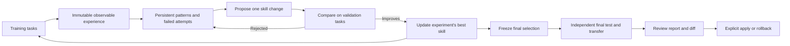

# 学習とスキルの改善

任意で使える改善ループは、観測できるタスクの結果から学び、wiki にパターンとしてまとめ、1つのスキル全体に対する変更を提案し、検証の結果で改善を選ぶ。独立した最終テストを実行する前に、選んだスキルを固定する。インストール済みのスキルが変わるのは、ユーザーが得られた改善案を適用したときだけである。

## 研究上の根拠と取り入れ方

改善の仕組みは、Liyan Tang らによる [WikiSkill: Compiling Agent Experience into Persistent Knowledge for Skill Evolution](https://arxiv.org/html/2608.27454v1)（Google Research と Virginia Tech、2026 年）をもとにしている。論文の[手法](https://arxiv.org/html/2608.27454v1#S3)と LLM Wiki の実装は、次のように対応する。

| 論文のアイデア | LLM Wiki での実装 |
| --- | --- |
| 経験、蓄積した知識、スキルを分ける | 変更不可の学習時の記録、既存のソースページとコンセプトのページ、独立したスキルのディレクトリ |
| 実行、統合、提案を繰り返す | `wiki_evolve_loop.py` で、推論、メンテナー、プロポーザーの呼び出しを回数に上限を設けて行う |
| 提案が失敗しても教訓を残す | 永続的なパターンと採否の履歴。却下された提案や重複した提案も、あとから確認できる |
| 出典を付けてスキルを作成・改良する | 複数のテキストファイルにまたがる、スキル全体または新しいスキルの提案。証拠との対応は `PURPOSE.md` に記録する |
| 検証で採否を決め、独立してテストする | 検証で厳密に改善した候補を選ぶ。最終テストと、任意で行う別のエージェントやモデルへの転用評価の前に、選定結果を固定する |
| 評価中はスキルを直接渡す | ハッシュ付きでスキル全体を注入する。スキルが起動しないことによる失敗は、測定する比較の対象から外す |

このプロジェクトでの取り入れ方には、論文と異なる点がある。推論には事実情報のタスク用 wiki を使わせ、最適化側の学習履歴は見せない。1回の実行で扱うスキルは1つである。改善案は、論文のようにツールを使うプロポーザーではなく、渡された証拠から構造化された提案として作る。記録するのは公開されたツールの観測結果で、非公開の推論は残さない。スキルを段階的に見つけるネイティブの仕組みは測定していない。9つのホストのアダプター、取り込み・グラフ・ハイブリッド検索に対するアサーション、インストール済みスキルへの明示的な承認、持ち運べる証拠のバンドル、リクエスト前に API の支出を予約する仕組みは、このプロジェクト独自の実装上の選択である。

これは論文を取り入れたものであり、論文のベンチマーク研究を再現したものではない。[公開したワークフローの研究](https://github.com/praneybehl/llm-wiki-plugin/blob/codex/wiki-skill-evolution/eval/evolution/workflows/README.md)では、提案された2つの変更はどちらも却下され、品質の向上は示されなかった。変更しないスキルとの比較で、Codex は 3/8 対 2/8、Claude は 3/8 対 3/8 だった。レポートには、当初の評価器の制約と、その後の訂正も残している。5つのホストは、まだアカウント、クライアント、ゲートウェイのセットアップが必要で、API の予算付きランナーは実際のキーを使った試験をしていない。



## サイクル全体を実行する

`/wiki:evolve` を使うか、スキルの改善を実行するようエージェントに頼む。事実情報のコーパス、学習用 wiki、raw ルート、対象のスキルは、それぞれ個別に指定する。作業用のスキルのコピーを使う。対象のディレクトリがなければスキルなしの状態から始まり、プロポーザーが新しくスキルを作る。知識のページを書く前に、wiki のスキーマを読む。

プラグインのリポジトリから `eval/evolution/pilot/config.example.json` をコピーし、アダプターのパスと正確なモデル ID を書き換える。ロールごとに専用のランナーとモデルを設定する。推論（inference）はタスクを実行し、メンテナー（maintainer）は経験を統合し、プロポーザー（proposer）はスキルを変更し、ジャッジ（judge）は回答を検証する。推論を始める前に、承認済みの実行予算を設定する。

```bash
python <skill-root>/scripts/wiki_evolve_loop.py \
  --wiki /path/to/learning-wiki --raw /path/to/raw \
  --id query-cycle-01 --skill /path/to/working-skill \
  --suite /path/to/suite-v2.json --config /path/to/config.json
```

ループは、上限のある回数だけ反復する。反復のたびに、学習時のツールイベント、回答、成果物、検証結果を記録し、再利用できるパターンを更新し、過去の試行を読み、複数のファイルにまたがる一貫した変更を提案し、それを現時点で最良のスキルと、繰り返し実行する検証用タスクで比べる。採用には、検証の成績が厳密に上回ることが必要である。任意で、コストやツール使用の比率、重要なタスクでの回帰チェックを設定し、選定をさらに絞ることもできる。却下された変更とその理由は後の提案で参照できる。一方、同じベースラインに対して却下済みの候補と重複するものはスキップする。

すべての反復が終わると、選定結果を固定する。ベースラインと選ばれたスキルを、最終テスト用のタスクで実行する。その結果はレポートに載せるが、メンテナーやプロポーザーには渡さず、別の候補を選ぶためにも使わない。任意の `transfer` 項目を設定すると、同じジャッジと予算のもとで、固定した同じ比較を別のエージェントとモデルの組み合わせで実行する。最終結果が悪いなら、採用を見送る理由になる。結果を見たテストに合わせて最適化してよいということにはならない。後で別の研究をするなら、新しいテスト用タスクを使う。学習用 wiki は、使用済みのテストのフィンガープリントを記録し、以降の最適化の実行で再利用されると拒否する。

実行が成功し、改善が選ばれると、`<run-id>-selected` ができる。これは既存のレビュー用・適用用のコマンドでそのまま扱える。

```bash
python <skill-root>/scripts/wiki_evolve.py --wiki /path/to/learning-wiki show query-cycle-01-selected
python <skill-root>/scripts/wiki_evolve.py --wiki /path/to/learning-wiki apply query-cycle-01-selected
python <skill-root>/scripts/wiki_evolve.py --wiki /path/to/learning-wiki rollback query-cycle-01-selected
```

`wiki_evolve.py history` と `show <run-id>` では、ループ全体の実行と、そこで残した判断も確認できる。実行が完了しても、変更が選ばれないことはある。実行時の失敗や予算切れでは、適用できる改善案は作られない。中断した実行は証拠を残すが、評価の入力をいったん見せたあとは、同じ ID で再開できない。

## タスクと検証

バージョン 2 のスイートでは、`train`、`validation`、`test` のタスクを分けることと、ジャッジを較正するための正例と負例が必要である。どのタスクにも、質問、意味で判定するルーブリック、回答を控えるべきかどうか、ソースのパスを持たせる。較正は学習の前に実行し、合格しなければならない。自分のジャッジを較正するときは、正しい言い換え、数値の誤り、矛盾、もっともらしいが裏づけのない追記を含めておく。

推論のランナーが受け取るのは、タスク、事実情報の wiki、書き込みの権限、スキルの内容全体だけである。ルーブリック、データの分割、期待する回答、どちらの候補かを示すラベル、学習履歴は受け取らない。アダプターはスキル全体を注入し、そのハッシュを返す。これで確かめられるのはスキルが渡されたことであり、モデルがすべての指示に従ったことではない。プロンプトでは実行の範囲と出力の形式を伝え、対象の手順そのものは教えない。

独立したジャッジが見るのは、質問、ルーブリック、回答、ソースのテキストで、スキルやどちらの候補かは見せない。ジャッジは、意味とソースによる裏づけを確かめ、ソースをそのまま引用して判定を返す。ハーネスは、その引用が実際にあるか、出典と回答の控え方が正しいかを検証し、求められた成果物を確認する。ジャッジがツールを呼び出したら、その実行は無効になる。ツールを余分に使って得た採点は、ブラインド評価の証拠として認めない。ジャッジは、測定したコマンドの出力と、ハッシュにもとづく整合性の観測結果も受け取る。取り込みのタスクでは raw の入力を `sources` に含め、要約が記録そのものに忠実かを確かめられるようにする。これでキーワードの一致に頼った誤りは減るが、較正したモデルのジャッジでも間違えることはある。重大な失敗はレビューし、効果を主張するときは、サンプル数、モデル、繰り返し実行した結果をあわせて報告する。

タスクの出力パスは、渡された wiki のルートからの相対パスである。タスクには、`allow_write` のパターンと `artifacts` のチェックを宣言できる。チェックの種類は、完全一致の `text` と `json`、含まれるべきテキスト片（`contains`）、オブジェクトやリストに再帰的に含まれるか（`json_subset` と `jsonl_subset`）、存在しないこと（`absent`）である。`required_commands` を使うと、実行したと主張しただけのものや、ソースの文中に引用されたコマンドは認めず、実際のシェルツールへの入力に指定のテキスト片が含まれることを求められる。これにより、新しくコピーした作業領域で、取り込み、編集、生成された出力を評価できる。宣言していない変更をしたタスクは、完了していても 0 点とし、違反のハッシュと成果物を残す。その場合は意味の採点をスキップし、使い捨てのコピーを破棄して比較を続ける。ランナー、認証、プロトコルの失敗では、これまでどおり実行を中止する。元のソースファイルは、タスクで明示的に許可しない限り保護される。作り直せる `.wiki-cache/` への書き込みは、隔離されたコピーの中では許可する。Bash を使えるアダプターは既存の検索スクリプトを実行でき、コピーしたスキルと実行時の依存パッケージがそろっていれば、ハイブリッド検索も実行できる。

ワークフローの試験では、トップレベルの `runtime_python` に、固定したバージョンの依存パッケージをインストール済みのインタープリターを絶対パスで指定し、推論の前に `setup_wiki.py` を実行してローカルのモデルを準備する。どちらの候補にも同じインタープリターを使う。ランナーは、ONNX のテレメトリーと、バイトコードの書き出しを無効にする。エージェントには、準備済みの実行環境を使い、パッケージのインストールやホストのキャッシュのコピーをしないよう伝える。

リポジトリのフィクスチャ `eval/evolution/pilot/suite-v2.json` には、成果物を作るものを含め、架空の Lark を題材にした 23 のタスクがある。これは公開用のデモであり、実際のプロジェクトの知識を代表するものでも、汎化を示す証拠でもない。製品について判断する前に、代表的な非公開のコーパスと独立したタスクに置き換える。既存の検索のベンチマークは、これとは別のものである。

追加の `eval/evolution/workflows/` スイートは、公開リポジトリの仕様に対する 16 のタスクを固定したものである。取り込み、ソースとコンセプトの出典、インデックスとログの更新、グラフのコンパイル、実際のハイブリッド検索の出力を含む。ソースのマニフェストには、公開コミットとハッシュが記されている。対応する研究のプロトコルと結果では、実行の失敗、インフラによる障害、測定した結果を区別している。

最終レポートには、対応のある正解率の差、タスク単位のクラスターブートストラップによる区間、対応のあるランダム化検定が含まれる。繰り返し実行した結果はタスクごとにまとめて扱い、独立したサンプルとしては数えない。信頼度の閾値は、主たる比較と転用の比較をあわせて調整する。`benefit_demonstrated` を立てるには、スキルが実際に変わっていることと、最終テストで良い結果が出ていることが必要である。実装のテストに通ったこと、ベースラインと同点であること、繰り返し回数を増やしたことでは立たない。これらの測定値は、サンプルとして選んだタスクについてのものであり、どんな場合にも性能を保証するものではない。

## エージェントのアダプターと予算

共通のアダプターは、`claude`、`codex`、`cursor`、`gemini`、`opencode`、`pi`、`omp`、`hermes`、`openclaw` に対応している。どのアダプターも、4つのロールの仕様を扱う。先に対応するホストをインストールして認証しておく。プロトコルのテストは、実際のアカウントでの確認の代わりにはならない。

```json
{"argv":["python3","/absolute/skill/scripts/wiki_evolve_agent.py","codex"],"model":"EXACT_MODEL_ID"}
```

| アダプター | 実行方法とモデルの選択 | 使用量の記録 |
| --- | --- | --- |
| Claude Code | `claude` のストリーム JSON と、ネイティブの構造化出力 | 報告されたトークン数と USD |
| Codex | `codex exec` の JSON イベントと出力スキーマ | トークン数。USD は取得できない |
| Cursor | `cursor-agent` のストリーム JSON。無関係な `agent` 実行ファイルで代用しない | トークン数と USD は取得できないことがある |
| Gemini CLI | ヘッドレスのストリーム JSON、モデルの明示指定、自動検出したスキルの無効化 | 報告されたトークン数。USD は取得できない |
| OpenCode | `opencode run --pure --format json`、`provider/model` の明示指定 | 報告されたトークン数とモデルのコスト |
| Pi / OMP | 一時的な JSON モード、制限したツール一覧、自動検出したスキルや拡張機能なし | 報告された使用量とモデルのコスト |
| Hermes | 認証済みのホストのプロファイルで新しい ACP セッションを開く。明示した `provider:model` が推論の前に解決できなければならない | 公開されていれば補完のトークン使用量。USD は取得できない |
| OpenClaw | 設定済みのローカルゲートウェイへの ACP ブリッジ。新しいセッションを開き、正規の `provider/model` をセッションの RPC で確かめる | コンテキストのおおよその使用量は、課金されたトークン数として扱わない。取得できない値は null のまま |

Hermes のランナーでは、`"options":{"home":"/absolute/hermes-eval-profile"}` を設定して、設定を管理した既存のプロファイルを使える。アダプターが認証情報をコピーしたり移動したりすることはない。OpenClaw のランナーでは、`"options":{"profile":"wiki-eval"}` を設定して、既存の隔離されたゲートウェイのプロファイルを選べる。ゲートウェイは、渡されたローカルの作業領域にアクセスでき、ツールの入出力を公開し、必要な操作をゲートウェイ自身のポリシーで許可していなければならない。ACP の権限リクエストで承認するのは、範囲を限った読み取りだけである。変更や実行には、事前に設定した範囲の限られたホストのポリシーが必要になる。Hermes は、モデルを選んだあと、新しい空のセッションを読み込み直して、解決されたプロバイダーとモデルを確かめる。モデルの設定に失敗した場合や、プロバイダーが黙って別のものに切り替わった場合は、タスクのプロンプトを送る前に止める。ホストには、それぞれ独自のシステムポリシーが残る。アダプターが正常に応答したからといって、そうしたポリシーがないとは判断できない。

ジャッジは、チェック済みの成果物と、変更されたすべてのテキストの成果物を受け取る。生成されたグラフのファイルも含む。ソースをそのまま引用した証拠では、保存したそれらの成果物を参照して、観測した状態を示してよい。ただし、新しく書いた事実の主張には、引き続き事実情報のソースによる裏づけが必要である。バイナリの成果物はハッシュを残すが、ジャッジ向けにデコードはしない。

観測できるツールイベントは、届くたびに `trace-NNNNN.jsonl` に追記し、fsync する。タイムアウトやクラッシュの記録は、残っているトレースのハッシュを参照し、量を限ったエラーの診断情報を残す。非公開の推論とプロンプトのエコーは含めない。取得できなかった使用量は `null` とし、0 をでっち上げることはない。コストの指標が取得できないまま選定しようとすると、安全側に倒して失敗する。旧来のエントリーポイントである `wiki_evolve_claude.py` も、引き続き使える。

すべてのロール、較正、検証、最終テスト、転用のランナーを、1つの台帳で数える。`max_calls` に達するとそれ以上ランナーを起動せず、`max_seconds` は実行時間の合計を制限し、`timeout` は期限が来たプロセスグループごとに終了させる。親プロセスが終了する前に見つかった、切り離された子孫プロセスも終了の対象である。子孫プロセスを片づけるには、ホストがプロセスの調査を許可している必要がある。これらはランナーとプロセスについての制限であり、CLI が内部で行う見えないモデルへのリクエストの数は数えない。CLI の試験では `max_usd: null` にする必要がある。CLI がリクエストのあとに報告するコストや、CLI ネイティブの閾値では、金額の上限を確実には守れないためである。

リクエストの前に金額の上限を守るには、**すべてのロールと転用のランナー**で、同梱の API ランナーを使うよう設定する。

```json
{"argv":["python3","/absolute/skill/scripts/wiki_evolve_api.py"],"model":"claude-sonnet-5"}
```

`budget.max_usd` を設定し、環境変数 `ANTHROPIC_API_KEY` を用意する。ランナーは Messages API へのリクエストのたびに、その前に、ドキュメントに記載された入力コンテキストの上限と最大出力の合計を、レビュー済みのファーストパーティの価格で予約する。予約できないリクエストは送らない。応答が返ってきたら、実際の使用量で精算する。応答がなかった場合は予約を残したまま、再試行せずに試験を中止する。十進数で計算するので、浮動小数点の誤差が積み重なって上限を超えることはない。予約は保守的に見積もるので、実際のリクエストのコストがずっと小さそうでも、Sonnet 5 では残額が少なくとも $2.08192 必要になる。

この上限が対象にするのは、固定した料金でのこのランナーによる標準のファーストパーティの推論で、税金とアカウントのほかの利用は含まない。このランナーは、キャッシュ、サーバーツール、プレミアムなルーティング、任意のシェル実行を無効にする。推論で使えるツールは、許可された wiki のファイルの読み取り、一覧、書き込みである。シェルを使うワークフローの評価には、CLI のランナーを使う。レビュー済みの価格表は 2026-10-13 に期限が切れ、レビューし直すまでは実行を拒否する。対応していないモデルは、推論の前に失敗する。価格とコンテキストについての前提は、[Claude の料金](https://platform.claude.com/docs/en/about-claude/pricing)に記載されている。プラグインには、API キーも、有料の API を実際に使った試験も同梱していない。

アダプターは、周囲の環境から入る指示を減らし、ネイティブの制限モードやサンドボックスモードを使う。それでも、ホストが管理するポリシーが適用されることはある。作業領域のコピー、ハッシュ、書き込みのチェックが対象にするのは、コピーした作業領域であり、ホストのファイルシステム全体ではない。ネイティブのポリシーでは、共有の一時ディレクトリへの書き込みが許可されることがある。ランナーは信頼されたローカルのコードであり、任意の実行ファイルを閉じ込めるセキュリティサンドボックスではない。全体で書き込みを隔離する必要があるなら、別に隔離したホストを使う。外部のモデルを呼び出すと、渡したコンテキストは選んだプロバイダーに送られる。非公開のソース、記録、認証情報は、公開するフィクスチャに含めない。

## 証拠、保存、復旧

学習時の raw の観測結果は、`raw/experiences/` に変更不可の形で保存する。ソースページとコンセプトのページ、インデックスのリンク、ログの項目によって、観測した結果と永続的なパターンを結びつける。`.evolution/learning.json` には、実行をまたいで統合と提案の履歴を残す。プロポーザーが受け取るのはこの学習の履歴であり、最終テストのレポートは受け取らない。モデルが書いた無効なパッチ（SKILL.md の削除を含む）は、却下された提案としてアーカイブし、残りの反復と最終テストには最後に有効だったスキルを使う。変更していないファイルはパッチに含めてはならない。null は削除を明示的に意味する。`PURPOSE.md` は選ばれたスキルと一緒に持ち運ばれ、その理由、パターンの適用範囲、もとになった実行とタスクの証拠を記録する。

同梱の改善用の実行環境が実行中に変わると、ハーネスはそれ以降の呼び出しを拒否する。呼び出しの実行中に同時編集が起きると、その呼び出しを無効にする。実行ごとのアーカイブには、固定した設定とコーパス、ハッシュ付きの改善用の実行環境のスクリプト、観測できる呼び出しの記録、実行時の成果物、候補のスナップショット、反復ごとの判断、選定結果、最終結果が含まれる。`.evolution/` はバックアップしておく。`.wiki-cache/` と違い、消えては困る証拠である。通常の検索、lint、stats、グラフのツール、ホスト型のサーバー、`wiki_remote.py import` は、このアーカイブを対象から外す。検索できる教訓は、通常の wiki ページに残る。

適用とロールバックでは、1つのスキルの中でのファイルの追加、編集、削除を扱える。インストール済みのスキル全体を確認し、同時編集があれば拒否する。移行の記録（ジャーナル）により、複数のファイルの書き込みが途中で中断しても復旧できる。この操作は復旧できるが、無関係な読み手から見てアトミックではない。移行中は、対象のスキルを同時に使わないようにする。中断したら、同じ適用またはロールバックを再実行する。終了したプロセスが残した空のロックを削除する前に、古い wiki とスキルのロックを確認する。合格の結果を無理に出すために、証拠やスナップショットを編集してはならない。

完了した実行は、持ち運べる1つのバンドルとしてエクスポートできる。

```bash
python <skill-root>/scripts/wiki_evolve.py --wiki /path/to/wiki export query-cycle-01 --destination /path/to/new-bundle
python <skill-root>/scripts/wiki_evolve.py verify-bundle /path/to/new-bundle
```

バンドルには、`skill/`、`evidence/`、すべてのファイルを対象にした SHA-256 のマニフェストが含まれる。`PURPOSE.md`、パターンとの対応、観測できる実行の記録、却下された試行、固定したソースの文脈が一緒に持ち運ばれる。後で推論の作業領域に置いてよいのは `bundle/skill` だけである。監査用のアーカイブには結果を見たテストが含まれるので、スキルの指示として注入してはならない。検証で確かめるのはマニフェストであり、デジタル署名でも、元の観測が正しかったことの証明でもない。

## 経験の手動記録と手動の改善案

`/wiki:learn` は、最適化を始めずに、完了した作業を記録する。インストール済みの `.experience-template.json` と `.pattern-template.md` を使い、検証できる成功と失敗を残し、ソースの証拠を取り込み、新しいパターンを作る前に既存のパターンに統合する。

スキル全体の改善案を手動で作る場合は、候補のディレクトリを渡す。既存の1ファイルだけを対象にする場合は、引き続き `--target` を使う。

```bash
python <skill-root>/scripts/wiki_evolve.py --wiki /path/to/wiki propose \
  --id query-manual-01 --skill /path/to/working-skill \
  --candidate /path/to/candidate-skill --evidence concepts/query-pattern.md \
  --reason "Address the verified failure"
```

旧来の `wiki_evolve.py evaluate` コマンドとバージョン 1 の `suite.json` は、決定的な回帰チェックとして引き続き使える。採否の判定には、検証用のセットと、歴史的な経緯で「holdout」と呼ばれているセットの両方が使われ、どちらも独立した最終テストではない。最適化と汎化の測定には、バージョン 2 のループを使う。

このプロジェクトの SemVer の方針では、バージョン 3.2.0 は機能の追加のみである。既存の wiki はそのまま使い続けることも、`/wiki:upgrade` で任意のテンプレートを追加することもできる。スキルの改善案を適用しても、プラグインのリリースが公開されることはない。
